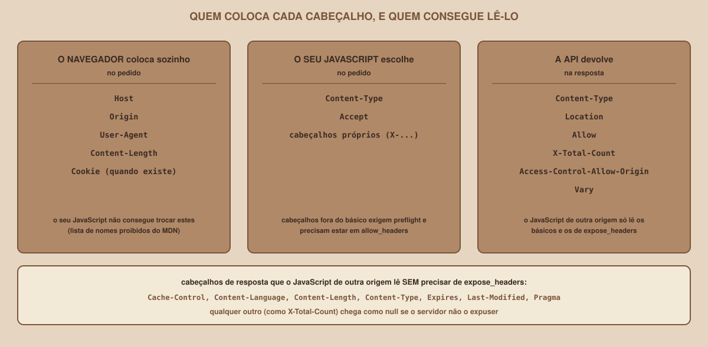

# Module 02, Headers

[Português](../docs/02-headers.md) · English

`WEEK 06 // Central RESTful API, Part 2: Integration`

---

## // Before you start

In Module 01 you saw that a request and a response have **headers**. They looked like a detail, and they are not: almost every integration error has a header in the middle of it, missing, wrong or hidden. This module shows which headers matter, who sets each one, and which ones your JavaScript can read.

## // The problem: the same request, different results

Imagine two identical requests to the API: one made with `curl` and another made by the page. The first works, and the second does not. The URLs are the same, the data is the same. The difference is in headers nobody wrote by hand: the browser added one of them to the request, and the response came back without another one it expected.

## // What a header is

> **HEADER: IN SIMPLE WORDS**
> It is extra information that travels along with the request or the response, in the `name: value` format, one per line. It describes what is being sent (the format, the size), who is asking, or what is allowed to be done with the response.

Header names are **case-insensitive**: `Content-Type` and `content-type` are the same. In JavaScript, you can confirm this: `resposta.headers.get("X-Total-Count")` and `resposta.headers.get("x-total-count")` return the same value.

## // The headers of a real conversation

These are the lines of a real conversation with the API, already with CORS configured, seen through `curl` in verbose mode. First, a `GET` that the page would make:

```
> GET /grupos?limit=2 HTTP/1.1
> Host: 127.0.0.1:8000
> User-Agent: curl/X.Y
> Accept: */*
> Origin: http://127.0.0.1:5500
>
< HTTP/1.1 200 OK
< server: uvicorn
< content-length: 285
< content-type: application/json
< x-total-count: 6
< access-control-expose-headers: X-Total-Count
< access-control-allow-origin: http://127.0.0.1:5500
< vary: Origin
```

And a `POST` with a JSON body:

```
> POST /grupos HTTP/1.1
> Host: 127.0.0.1:8000
> User-Agent: curl/X.Y
> Accept: */*
> Content-Type: application/json
> Content-Length: 51
>
< HTTP/1.1 201 Created
< server: uvicorn
< content-length: 146
< content-type: application/json
< location: /grupos/7
< vary: Origin
```

(In both, the real response also carries the `date` header, omitted here.)

## // The request headers

| Header | Who sets it | What it is for |
|---|---|---|
| `Host` | The client, automatically | The destination server and port |
| `User-Agent` | The client, automatically | Who is asking (the browser, `curl`...) |
| `Accept` | The client | The response formats it accepts |
| `Content-Type` | **You**, when you send a body | The body's format: `application/json` for JSON |
| `Content-Length` | The client, automatically | The body's size, in bytes |
| `Origin` | **The browser**, on cross-origin requests | The origin of the page that made the request (the basis of CORS) |

## // The response headers

| Header | What it is for | Where it shows up this week |
|---|---|---|
| `Content-Type` | The format of the response body | `application/json` in every response with a body |
| `Content-Length` | The body's size | In responses with a body |
| `Location` | The address of the newly created resource | In the `201` of `POST /grupos` |
| `Allow` | The methods the route accepts | In the `405` response |
| `X-Total-Count` | The total number of groups, for pagination | In `GET /grupos` (Module 13) |
| `Access-Control-Allow-Origin` | The origin allowed to read the response | In the CORS responses (Module 09) |
| `Vary` | Tells caches the response depends on another header | `vary: Origin` |

## // Who sets each header

<div align="center">

</div>

One distinction that will save you a lot of headaches: there are headers that **only the browser** may set. Your JavaScript can try to change `Origin` or `Host`, and the browser ignores the attempt. The MDN documentation keeps a list of these forbidden names (among them `Host`, `Origin`, `Content-Length` and `Cookie`). This exists for safety: one page cannot pretend to be another.

`Content-Type` and `Accept`, on the other hand, are yours to choose, and so are your application's own headers (many start with `X-`, an old convention). But there is a cost: a header outside the basic set makes the request "not simple", and the browser starts doing the **preflight** from Module 09, which requires the API to allow the header in `allow_headers`.

## // What your JavaScript can read

In a `fetch`, the response headers live in `resposta.headers`:

```js
const resposta = await fetch("http://127.0.0.1:8000/grupos?limit=2");
console.log(resposta.headers.get("content-type"));       // "application/json"
console.log(resposta.headers.get("x-total-count"));      // "6"
console.log(resposta.headers.get("x-nao-existe"));       // null
```

This code, run in Node against the real API, returned exactly the values in the comments. Notice two details: a header's value is always **text** (`"6"`, not `6`), and a header that does not exist returns `null`.

When the page and the API are on **different origins**, there is one more restriction: the browser only lets JavaScript read the "basic" response headers (`Cache-Control`, `Content-Language`, `Content-Length`, `Content-Type`, `Expires`, `Last-Modified` and `Pragma`) plus the ones the server lists in `Access-Control-Expose-Headers`. Any other one arrives as `null`, even though it is in the response. That is why `X-Total-Count` needs `expose_headers=["X-Total-Count"]` on the API. Source: the MDN documentation and the Fetch specification, consulted on 2026-10-08. This behaviour belongs to the **browser**: Node, which does not apply CORS, hands over every header, which is why it did not reproduce it.

## // The header that causes the most trouble: Content-Type

When you send JSON, `Content-Type: application/json` is mandatory. If it is missing, `fetch` sends the body as plain text (the default, for a text body, is `text/plain;charset=UTF-8`, according to the specification), and the API does not recognize it as JSON. Real result, when sending the right body without the header:

```
POST /grupos   (no Content-Type)

422  {"detail":[{"type":"model_attributes_type", ...,
    "msg":"Input should be a valid dictionary or object to extract fields from"}]}
```

The message talks about a "dictionary", and does not mention the header. Someone who does not know this looks for the error in the body, and it is in the header that was missing.

## // Good example × bad example

**Bad example**: sending JSON without saying it is JSON:

```js
await fetch(`${API}/grupos`, {
  method: "POST",
  body: JSON.stringify({ nome_grupo: "Redes", materia_id: 5 }),
});
```

**Good example**: declaring the body's format:

```js
await fetch(`${API}/grupos`, {
  method: "POST",
  headers: { "Content-Type": "application/json" },
  body: JSON.stringify({ nome_grupo: "Redes", materia_id: 5 }),
});
```

## // Common mistakes

| Mistake | Why it happens | How to fix it |
|---|---|---|
| `422` when sending JSON, even with the right body | `Content-Type: application/json` was missing | Add the header to the `fetch` |
| `headers.get("x-total-count")` returns `null` | The API did not expose the header (`expose_headers`) to the browser | Add the header to the CORS `expose_headers` |
| Trying to change `Origin` from JavaScript | It is a forbidden header: the browser ignores it | Do not try: it is the basis of CORS |
| Expecting a number and getting text | Every header value is text | Convert it with `Number(...)` |
| The preflight fails after adding a custom header | The header is not in `allow_headers` | Allow the header on the API (Module 09) |
| Comparing header names case-sensitively | The names are case-insensitive | Use `headers.get(...)`, which already handles it |

## // Guided practice

1. Run the API (Module 03) and run `curl -v "http://127.0.0.1:8000/grupos?limit=2"`. Identify, in the `>` lines, the headers `curl` sent on its own.
2. Run the same command with `-H "Origin: http://127.0.0.1:5500"` and compare the `<` lines: what changed (and what is still missing, if the API is still without CORS)?
3. Run a `POST` with `-H "Content-Type: application/json"` and read the `location` and the `content-length` of the response.
4. Run the same `POST` **without** the `-H` and read the `422`.
5. In the Network tab of any site, click a request and locate the request and response headers.

## // Practice on your own

> **CHALLENGE**
> Write, in a file, a table with three columns: the header, who sets it (browser, your JavaScript or the API) and what happens if it is missing. Fill it in for: `Content-Type` in the request, `Origin`, `Location`, `Access-Control-Allow-Origin` and `X-Total-Count`. Then check each row against what you saw in `curl -v`.

## // Applying it to this week's project

1. In `anotacoes-http.md`, add a "Cabeçalhos" section with the challenge's table.
2. Write down, in one line, which header you need to expose so the page can read the total number of groups.
3. If you track the project with Git, make a commit: `git commit -m "Anota os cabeçalhos da integração"`.

## // Checkpoint

> **BEFORE MOVING ON, THINK ABOUT THIS**
> The API returns `x-total-count: 6`, and the browser's Network tab shows the header in the response. Even so, your JavaScript gets `null` when asking for `resposta.headers.get("X-Total-Count")`. What is going on?

Answer: the page and the API are on different origins, and the browser only hands JavaScript the basic headers and the ones listed in `Access-Control-Expose-Headers`. The Network tab shows everything that **arrived** at the browser, but JavaScript may only **read** what the server allowed. The fix is on the API: `expose_headers=["X-Total-Count"]`.

## // Module summary

- [ ] I know what a header is and that the name is case-insensitive.
- [ ] I know the main request and response headers and who sets each one.
- [ ] I know that some headers can only be set by the browser.
- [ ] I can read headers in JavaScript with `resposta.headers.get(...)`.
- [ ] I know that, across different origins, only the basic and the exposed headers are readable.
- [ ] I know why `Content-Type: application/json` is mandatory when sending JSON.

---

**Next module:** `03-the-api-we-will-use.md`, time to start this week's API and test it, before calling it from the page.

`Study Material // Coffee & Code`
