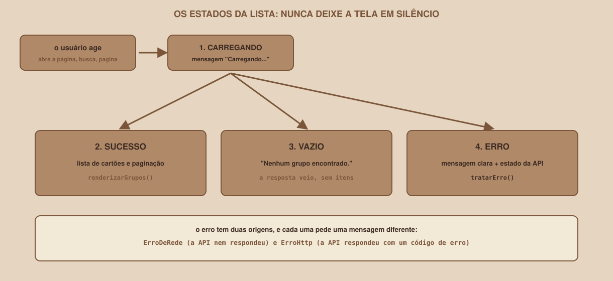

# Module 10, Listing Groups on the Page

[Português](../docs/10-listando-grupos-na-pagina.md) · English

`WEEK 06 // Central RESTful API, Part 2: Integration`

---

## // Before you start

With CORS solved, the page finally receives the API's response. This module turns that response into a **list on screen**, and goes beyond the happy path: it handles the moments when the list has not arrived yet, is empty, or should not be shown at all because the API failed. That is what separates a page that "works in the demo" from one a user can trust.

## // The problem: a screen that stays silent

A list that simply shows up when the data arrives seems like enough. But think about the other moments: what does the person see **while** the API responds? And if the search finds nothing? And if the API is off? A screen that says nothing in those moments looks broken, and the person has no way of knowing whether to wait, try again or give up.

## // The list's four states

<div align="center">

</div>

| State | What the screen shows | Who handles it |
|---|---|---|
| **Loading** | The "Carregando..." message | `carregarGrupos()`, before the request |
| **Success** | The group cards and the pagination | `renderizarGrupos()` |
| **Empty** | "Nenhum grupo encontrado." | `renderizarGrupos()`, with a list of no items |
| **Error** | A clear message and the API's state | `tratarErro()` |

Every time the person acts (opens the page, searches, paginates), the list goes through **loading** and ends in one of the other three.

## // The API layer: listarGrupos

The list request lives in `api.js`. It builds the parameters with `URLSearchParams` (Module 04) and reads the total number of groups from the header (Module 13 explains the header):

```js
export async function listarGrupos(
  { busca = "", materiaId = "", limite = 4, deslocamento = 0 } = {}
) {
  const parametros = new URLSearchParams({ limit: limite, offset: deslocamento });
  if (busca) parametros.set("q", busca);
  if (materiaId) parametros.set("materia_id", materiaId);

  const { dados, resposta } = await pedir(`/grupos?${parametros}`);
  const total = resposta.headers.get("X-Total-Count");
  if (total === null) {
    console.warn(
      "X-Total-Count não está visível. Confira o expose_headers do CORS na API."
    );
  }
  return { grupos: dados, total: total === null ? dados.length : Number(total) };
}
```

## // The interface layer: rendering

`ui.js` knows nothing about the API: it receives ready-made data and writes it onto the page. Each group becomes a card, built with `createElement` and `textContent`, as Module 05 taught:

```js
export function renderizarGrupos(
  grupos, nomesDeMaterias, { aoEditar, aoApagar }
) {
  const lista = $("lista-grupos");
  lista.replaceChildren();

  if (grupos.length === 0) {
    const vazio = document.createElement("li");
    vazio.className = "vazio";
    vazio.textContent = "Nenhum grupo encontrado.";
    lista.append(vazio);
    return;
  }

  for (const g of grupos) {
    const item = document.createElement("li");
    item.className = "cartao";

    const titulo = document.createElement("h3");
    // textContent: o texto da API nunca vira HTML
    titulo.textContent = g.nome_grupo;
    // ...matéria, limite e descrição, no mesmo estilo...
  }
}
```

Three decisions worth noticing:

- The list is **emptied** before every draw (`replaceChildren()`), so cards do not pile up.
- An empty list **is not an error**: the API answered `200` with no items, and the screen explains that with a sentence.
- The subject's name comes from a `Map` (`nomesDeMaterias`) built once, from `GET /materias`. The group only carries the `materia_id`, and showing a number would be useless to the person.

## // The orchestrator: carregarGrupos

`app.js` joins the two layers, and it is where the states live:

```js
// numera os pedidos de listagem, para descartar respostas atrasadas
let ultimoPedido = 0;

async function carregarGrupos() {
  const numero = ++ultimoPedido;
  ui.mostrarMensagem("Carregando...");
  try {
    const { grupos, total } = await api.listarGrupos({
      busca: estado.busca,
      materiaId: estado.materiaId,
      limite: TAMANHO_DA_PAGINA,
      deslocamento: (estado.pagina - 1) * TAMANHO_DA_PAGINA,
    });
    // já existe um pedido mais novo: esta resposta é velha
    if (numero !== ultimoPedido) return;

    const totalDePaginas = Math.max(1, Math.ceil(total / TAMANHO_DA_PAGINA));
    if (estado.pagina > totalDePaginas) {
      estado.pagina = totalDePaginas;
      return carregarGrupos();
    }

    estado.total = total;
    ui.mostrarEstadoApi("conectada");
    ui.renderizarGrupos(grupos, estado.nomesDeMaterias, {
      aoEditar: iniciarEdicao,
      aoApagar: apagar,
    });
    ui.renderizarPaginacao({ pagina: estado.pagina, totalDePaginas, total });
    ui.mostrarMensagem("");
  } catch (erro) {
    if (numero !== ultimoPedido) return;
    tratarErro(erro);
  }
}
```

Two lines call for an explanation.

### > The request number: out-of-order responses

Imagine the person clicking **Próxima** and, right after, picking a subject in the filter. Two requests are in flight. If the **first** (the older one) takes longer and arrives **after** the second, it overwrites the screen with data the person no longer asked for. It is a race condition, and it is real.

The fix is to number each request (`++ultimoPedido`) and, on receiving the response, check whether it is still the **newest** (`numero !== ultimoPedido`). If it is not, it is discarded. This behaviour was verified in a test that deliberately delays the old response: with the check, the screen shows the new response. **Without** the check (tested by removing the line), the test fails, which shows that it really detects the defect.

### > The page that stopped existing

If the person is on the last page and deletes its only item, the total drops and the page no longer exists. Without the precaution, the screen would show "Página 3 de 2", with no cards at all. The three lines of `if (estado.pagina > totalDePaginas)` go back to the last page that exists and reload.

## // The error: two sources, two messages

```js
function tratarErro(erro) {
  if (erro instanceof api.ErroDeRede) {
    ui.mostrarEstadoApi("fora");
    ui.mostrarMensagem(erro.message, "erro");
  } else if (erro instanceof api.ErroHttp) {
    ui.mostrarMensagem(`A API respondeu com o código ${erro.status}.`, "erro");
  } else {
    console.error(erro);
    ui.mostrarMensagem("Algo inesperado aconteceu. Veja o console.", "erro");
  }
}
```

Each branch says something different to the person: the `ErroDeRede` ("the API did not answer") is a connection problem, which they may be able to fix; the `ErroHttp` ("the API answered with an error") is a system problem. With the API off, the automated test confirms the result:

```
estado da API: "API fora do ar"
mensagem: "Não foi possível falar com a API. Ela está ligada?"
```

## // Search and filter

Search by name runs **while the person types**, but not on every letter: a small delay (`comAtraso`, of 300 milliseconds) waits for the person to stop typing, so there is not one request per key. Every new search goes back to page 1. The subject filter uses the `change` event, which fires when the choice changes.

Results verified in a test against the real API: with no filters, the page shows the first four groups in alphabetical order (`Cálculo passo a passo`, `Estruturas na prática`, `Modelagem e SQL` and `Processos e memória`); the search `prática` shows only `Estruturas na prática`; the search `zzz` shows "Nenhum grupo encontrado."; and the filter by subject 3 shows only `Modelagem e SQL`.

## // Good example × bad example

**Bad example**: drawing the list only when it works:

```js
const grupos = await api.listarGrupos();
renderizar(grupos);        // se a API cair, a tela não muda e nada é dito
```

**Good example**: each state has its own drawing:

```js
ui.mostrarMensagem("Carregando...");
try {
  const { grupos } = await api.listarGrupos();
  renderizar(grupos);            // sucesso, ou a mensagem de lista vazia
  ui.mostrarMensagem("");
} catch (erro) {
  tratarErro(erro);              // erro de rede, ou erro HTTP
}
```

## // Common mistakes

| Mistake | Why it happens | How to fix it |
|---|---|---|
| The list duplicates on every search | The new cards were added to the old ones | `replaceChildren()` before drawing |
| An "old" search shows up on screen | Out-of-order responses | Number the requests and discard the late ones |
| `Página 3 de 2` after deleting | The requested page stopped existing | Go back to the last page that exists |
| "Carregando..." stays on screen forever | The `try` does not clear the message, or the error was not handled | Clear the message on success and handle the error |
| One request per key typed | The search delay was missing | Use a delay (`comAtraso`) |
| The screen shows the subject's number | The `materia_id` was not swapped for the name | Build a `Map` from `GET /materias` |

## // Guided practice

1. Copy `example/frontend/api.js`, `ui.js` and `app.js` to `projeto-fullstack/frontend`, **or** write them piece by piece, in this module's order: `listarGrupos`, `renderizarGrupos`, `carregarGrupos`, `tratarErro` and `iniciar`.
2. Start the **API with CORS** (`example/api`), serve the page and open `http://127.0.0.1:5500`.
3. Check the first four groups and the "API conectada" state.
4. Search for `prática`, then `zzz`, then clear the search.
5. Pick a subject in the filter and go back to "Todas".
6. Turn the API off (Ctrl+C in its terminal) and use the search: read the message and the API's state.

## // Practice on your own

> **CHALLENGE**
> Add to each group's card a line with the **creation date** in Brazilian format (day/month/year). The API returns `criado_em` as ISO text (for example, `2026-09-03T12:00:00Z`). Hint: `new Date(g.criado_em).toLocaleDateString("pt-BR")`. Confirm the result for the group `Modelagem e SQL`, and use `textContent`.

## // Applying it to this week's project

1. Leave the listing working, with the four states, the search and the filter.
2. In `README.md`, describe each of the screen's four states in one sentence.
3. If you track the project with Git, make a commit: `git commit -m "Lista os grupos da API na página"`.

## // Checkpoint

> **BEFORE MOVING ON, THINK ABOUT THIS**
> `GET /grupos?q=zzz` returns `200` with an empty list. Should the page treat that as an **error** or as a **normal state**? And what should it show?

Answer: as a **normal state**. The API answered correctly, and there simply are no groups matching the search. The screen should say so clearly ("Nenhum grupo encontrado."), without using the error style, and the pagination should stay coherent. Treating an empty list as an error would alarm the person for no reason, and leaving it blank would make them think the page broke.

## // Module summary

- [ ] I know the list's four states (loading, success, empty and error) and how to show each one.
- [ ] I know how to split the work across `api.js`, `ui.js` and `app.js`.
- [ ] I know how to draw a list with `createElement` and `textContent`.
- [ ] I know how to tell `ErroDeRede` from `ErroHttp` and give each one the right message.
- [ ] I know how to discard out-of-order responses with a request number.
- [ ] I know how to handle the page that stopped existing.
- [ ] I know how to implement the delayed search and the subject filter.

---

**Next module:** `11-sending-data-form-and-post.md`, the page already reads data. What is left is sending it.

`Study Material // Coffee & Code`
