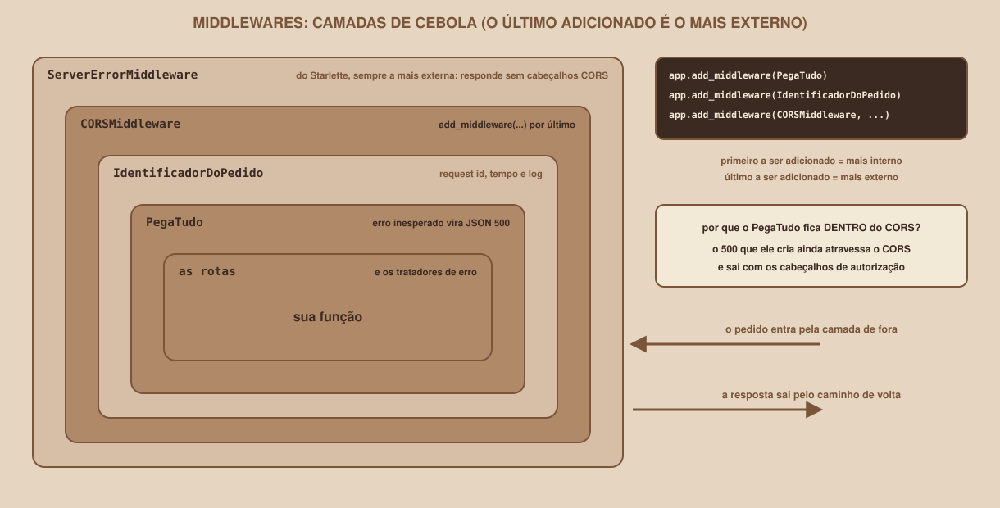

# Module 15, Request Middlewares

[Português](../docs/15-middlewares-de-requisicao.md) · English

`WEEK 06 // Central RESTful API, Part 2: Integration`

---

## // Before you start

> **VETERAN TRACK**
> This module is part of the veteran track: it comes after the essential content and is not required for the week's deliverable. Anyone following the main track can skip to `deliverable.md`.

You have already used a middleware without knowing its name: Module 09's `CORSMiddleware`. This module shows how to write **your own**, to solve three real integration problems: linking a complaint from the screen to a line in the server's log, measuring how long each request takes, and making an unexpected error reach the page as a readable `500`, and not as a CORS error. The complete code is in `example/veterano/api/`.

## // The problem: from the symptom to the log

The person says: "the page errored out at 2pm". On the server, there are thousands of log lines from that time. Without an identifier linking the two ends, finding the right request is guesswork. There are two neighbouring problems as well: nobody knows which requests are slow, and, when the API breaks with an unexpected error, the browser shows a CORS error instead of the real `500` (Module 09).

## // What a middleware is

> **MIDDLEWARE: IN SIMPLE WORDS**
> It is a layer of code that sits **between** the server and the routes. Every request passes through it on the way in, and every response passes through it on the way out. It can look, log, measure, add headers, or even respond in the route's place.

<div align="center">

</div>

Middlewares form **layers**, like an onion's: the request enters through the outermost layer, crosses each one until it reaches the route, and the response comes back along the same path. The **order** of the layers matters, and it decides the behaviour. Here is the rule, verified in a test with two middlewares that announce when they enter and leave:

```python
app.add_middleware(A)    # adicionado primeiro
app.add_middleware(B)    # adicionado depois
```

```
B (adicionado 2º): entra > A (adicionado 1º): entra > rota >
A (adicionado 1º): sai > B (adicionado 2º): sai
```

> **THE ORDER RULE**
> The **last** middleware added is the **outermost**: it is the first to see the request and the last to see the response. It looks backwards, because reading top to bottom in the code is reading **inside out**.

## // Writing a middleware: the ASGI skeleton

Starlette (FastAPI's foundation) lets you write a middleware as a plain class, in the **ASGI** pattern: it receives the next application and is called on every connection with three arguments.

| Argument | What it is |
|---|---|
| `scope` | A dictionary with the request's data (method, path, headers) |
| `receive` | A function for reading the request's body |
| `send` | A function for sending the response, in messages |

```python
class IdentificadorDoPedido:
    def __init__(self, app: ASGIApp):
        self.app = app

    async def __call__(self, scope: Scope, receive: Receive, send: Send):
        if scope["type"] != "http":
            return await self.app(scope, receive, send)
        # ...olhar o pedido, chamar self.app(...) e olhar a resposta...
```

The pattern is always the same: check that it is an HTTP connection, do what you want **before**, call `self.app(...)` (the next layer) and do what you want **after**. Starlette also offers a shorter form, the `BaseHTTPMiddleware` class, with a `dispatch` method, and it works (it was tested). This module uses plain ASGI because it shows exactly what passes through.

## // Middleware 1: identify, measure and log

The `IdentificadorDoPedido` does four things in one place:

```python
FORMATO_DO_ID = re.compile(r"^[A-Za-z0-9._-]{8,64}$")

class IdentificadorDoPedido:
    async def __call__(self, scope: Scope, receive: Receive, send: Send):
        if scope["type"] != "http":
            return await self.app(scope, receive, send)

        recebido = dict(scope["headers"]).get(b"x-request-id", b"")
        recebido = recebido.decode("latin-1")
        valido = FORMATO_DO_ID.match(recebido)
        identificador = recebido if valido else uuid.uuid4().hex[:12]
        scope.setdefault("state", {})["request_id"] = identificador
        inicio = time.perf_counter()
        codigo = 0

        async def enviar(mensagem: Message):
            nonlocal codigo
            if mensagem["type"] == "http.response.start":
                codigo = mensagem["status"]
                duracao = (time.perf_counter() - inicio) * 1000
                cabecalhos = list(mensagem.get("headers", []))
                cabecalhos.append((b"x-request-id", identificador.encode()))
                tempo = f"{duracao:.1f}ms".encode()
                cabecalhos.append((b"x-process-time", tempo))
                mensagem = {**mensagem, "headers": cabecalhos}
            await send(mensagem)

        try:
            await self.app(scope, receive, enviar)
        finally:
            duracao = (time.perf_counter() - inicio) * 1000
            logger.info(
                "request_id=%s metodo=%s caminho=%s status=%s ms=%.1f",
                identificador, scope["method"], scope["path"], codigo, duracao,
            )
```

| Part | What it does |
|---|---|
| `recebido` and `FORMATO_DO_ID` | Accepts an identifier sent by the client **only if** it has a safe format (8 to 64 letters, digits, dot, underscore or hyphen). An arbitrary value coming from outside does not go straight into the log |
| `uuid.uuid4().hex[:12]` | Creates a new 12-character identifier when the client did not send a valid one |
| `scope["state"]["request_id"]` | Makes the identifier available to the routes and the error handlers |
| `enviar(...)` | Intercepts the response's sending to **add** the `x-request-id` and `x-process-time` headers |
| The `finally` | Writes a log line **always**, even if the route fails |

### > What the API returns

```
GET /grupos?limit=2   (com Origin: http://127.0.0.1:5500)

HTTP/1.1 200 OK
x-request-id: 34c8e750cdbe
x-process-time: 2.4ms
access-control-expose-headers: X-Request-ID, X-Process-Time
access-control-allow-origin: http://127.0.0.1:5500
```

A **valid** identifier sent by the client is kept, and an **invalid** one is replaced:

```
X-Request-ID enviado: meu-pedido-0001   ->   x-request-id: meu-pedido-0001
X-Request-ID enviado: x                 ->   x-request-id: b251fa462c28
```

And the server's log records each request, one line per request, with the same identifier (the times were rounded here):

```
request_id=34c8e750cdbe metodo=GET caminho=/grupos status=200 ms=2.4
request_id=6bd607602de2 metodo=GET caminho=/grupos/99 status=404 ms=2.4
request_id=70960d45d4b3 metodo=POST caminho=/grupos status=201 ms=2.4
request_id=db0d3b05d6db metodo=DELETE caminho=/grupos status=405 ms=2.4
```

Now the person who complained can report the identifier the screen showed, and whoever maintains the API finds **the exact line** in the log.

## // Middleware 2: the catch-all

When a route raises an error nobody anticipated, Starlette handles it in a layer that **always sits outside all the others**, the `ServerErrorMiddleware`. The response it generates **does not pass through CORS**, and goes out without authorization headers: in the browser, the `500` becomes a CORS error (Module 09). Real result, even with an `@app.exception_handler(Exception)`:

```
GET /quebra   (com Origin permitida)

500  {"erro": "erro_interno"}      cabeçalhos CORS: nenhum
```

The fix is a middleware that catches the error **before** it reaches the outer layer, still **inside CORS**:

```python
class PegaTudo:
    async def __call__(self, scope: Scope, receive: Receive, send: Send):
        if scope["type"] != "http":
            return await self.app(scope, receive, send)

        iniciada = False

        async def enviar(mensagem: Message):
            nonlocal iniciada
            if mensagem["type"] == "http.response.start":
                iniciada = True
            await send(mensagem)

        try:
            await self.app(scope, receive, enviar)
        except Exception:
            identificador = scope.get("state", {}).get("request_id")
            logger.exception(
                "request_id=%s erro inesperado em %s %s",
                identificador, scope["method"], scope["path"],
            )
            if iniciada:
                raise  # a resposta já começou a sair: não dá para trocá-la
            corpo = {
                "erro": {
                    "codigo": "erro_interno",
                    "mensagem": "Erro interno do servidor",
                    "detalhes": None,
                },
                "meta": {"requestId": identificador},
            }
            await JSONResponse(corpo, status_code=500)(scope, receive, send)
```

Three decisions:

- The `iniciada` prevents a worse error: if the response has already started going out, it can no longer be swapped for a `500`, so the error is re-raised.
- The **internal detail goes to the log** (`logger.exception`, with the identifier), and **never** to the client: the response carries only the generic message.
- The `500` response uses the API's own error format (Module 16), with the `requestId`.

### > The proof that position matters

The same `PegaTudo`, in two positions, in a test:

| Position | `500` result |
|---|---|
| **Inside** CORS (added before it) | `500` in JSON, with `access-control-allow-origin` |
| **Outside** CORS (added after it) | `500` in JSON, **without** the CORS headers |

What the log records when the `/diagnostico/erro` route (which raises an error on purpose) is called:

```
request_id=8525fa0eceac erro inesperado em GET /diagnostico/erro
    raise RuntimeError("falha provocada de propósito")
```

And the client receives only this:

```
HTTP/1.1 500 Internal Server Error
x-request-id: 8525fa0eceac
access-control-allow-origin: http://127.0.0.1:5500
{"erro":{"codigo":"erro_interno","mensagem":"Erro interno do servidor",
         "detalhes":null},"meta":{"requestId":"8525fa0eceac"}}
```

The text `falha provocada` does not show up in the response: only in the log.

> **THE DIAGNOSTIC ROUTE**
> The `GET /diagnostico/erro` route exists only for studying the `500`. In a real system, **remove it**: a route that brings the application down on request is an invitation for abuse.

## // Assembling it in the right order

In the veteran API's `main.py`:

```python
# A ORDEM IMPORTA: o último middleware adicionado é o mais EXTERNO.
#   CORS  >  IdentificadorDoPedido  >  PegaTudo  >  rotas
app.add_middleware(PegaTudo)
app.add_middleware(IdentificadorDoPedido)
app.add_middleware(
    CORSMiddleware,
    allow_origins=["http://127.0.0.1:5500", "http://localhost:5500"],
    allow_methods=["GET", "POST", "PATCH", "DELETE"],
    allow_headers=["Content-Type"],
    expose_headers=["X-Request-ID", "X-Process-Time"],
)
```

| Layer | Why it sits there |
|---|---|
| `PegaTudo`, the innermost | Catches the error before it leaves the set. The `500` it creates still crosses the other two |
| `IdentificadorDoPedido`, in the middle | Sees the identifier, the status and the time of **every** response, including the catch-all's `500` |
| `CORSMiddleware`, the outermost of the three | Adds the CORS headers to **every** response that goes out, including the `500` |

### > Checking the real stack

You do not have to take the order on faith: FastAPI lets you **look** at the assembled stack. The code below walks the layers, from the outermost to the innermost, and prints each one's name:

```python
pilha = main.app.build_middleware_stack()
atual, nomes = pilha, []
while atual is not None:
    nomes.append(type(atual).__name__)
    atual = getattr(atual, "app", None)
print(" > ".join(nomes))
```

Real result, in this version, with the veteran API:

```
ServerErrorMiddleware
> ExceptionTelemetryMiddleware
> CORSMiddleware
> IdentificadorDoPedido
> PegaTudo
> ExceptionMiddleware
> AsyncExitStackMiddleware
> APIRouter
```

Recognize your three layers (`CORSMiddleware`, `IdentificadorDoPedido` and `PegaTudo`), in the expected order. The rest belong to the framework and **vary between versions**: the drawing at the start of the module shows only the ones that matter here. The `ServerErrorMiddleware` is, indeed, the outermost of them all.

The new headers have to be **exposed** (`expose_headers`), otherwise the page's JavaScript will not read them (Module 13). And watch out for a detail that goes the other way: if the **page** starts sending an `X-Request-ID` header, it has to be allowed in `allow_headers`. Real response to a preflight asking for that header, without the permission:

```
OPTIONS /grupos   (Access-Control-Request-Headers: x-request-id)

400 Bad Request
```

## // Using the identifier on the page

In the veteran front-end, the `ErroHttp` stores the identifier, read from the response header (readable thanks to the `expose_headers`) or from the error's body:

```js
export class ErroHttp extends Error {
  constructor(status, corpo, requestId) {
    super(corpo?.erro?.mensagem ?? `A API respondeu ${status}`);
    this.name = "ErroHttp";
    this.status = status;
    this.codigo = corpo?.erro?.codigo ?? null;
    this.detalhes = corpo?.erro?.detalhes ?? [];
    this.requestId = requestId ?? corpo?.meta?.requestId ?? null;
  }
}
```

And the screen's error message starts carrying the identifier:

```js
ui.mostrarMensagem(`${erro.message} (pedido ${erro.requestId})`, "erro");
```

The screen shows something like `Erro interno do servidor (pedido 8525fa0eceac)`. The person reports the identifier, and whoever maintains the API finds, in the log, the exact line and the exact error.

## // Good example × bad example

**Bad example**: logging the error without linking it to the request:

```
ERROR erro inesperado
Traceback (most recent call last): ...
```

In a log with thousands of lines, there is no way to know which request (and which person) this error came from.

**Good example**: the same identifier in the log, in the header and on the screen:

```
log:   request_id=8525fa0eceac erro inesperado em GET /diagnostico/erro
resp:  x-request-id: 8525fa0eceac
tela:  Erro interno do servidor (pedido 8525fa0eceac)
```

## // Common mistakes

| Mistake | Why it happens | How to fix it |
|---|---|---|
| The `500` shows up as a CORS error in the browser | The catch-all is **outside** CORS, or does not exist | Add the catch-all **before** CORS (the order of the `add_middleware` calls) |
| The page cannot read the `x-request-id` | `expose_headers` was missing | Add the headers to `expose_headers` |
| The preflight fails when the page sends `X-Request-ID` | The header is not in `allow_headers` | Allow the header |
| The log comes without the identifier | The identifier middleware is **inside** the catch-all, not outside it | Add the identifier **after** the catch-all |
| The client sees the internal error's detail | The catch-all returned `str(erro)` | Return only the generic message, and log the detail |
| An identifier coming from outside goes straight into the log | Validating the format was missing | Accept only values that match a safe pattern |
| The catch-all's error disappears | `except Exception: pass` with no logging | Always log with `logger.exception` |

## // Guided practice

1. Copy `example/veterano/api` to a new folder, install the dependencies and run `fastapi dev main.py`.
2. Run `curl -i "http://127.0.0.1:8000/grupos?limit=2"` and read the `x-request-id` and the `x-process-time`.
3. Repeat it with `-H "X-Request-ID: meu-pedido-0001"` and then with `-H "X-Request-ID: x"`. What changes?
4. Run `curl -i -H "Origin: http://127.0.0.1:5500" http://127.0.0.1:8000/diagnostico/erro` and check the `500` in JSON, with the CORS header. Look at the log in the API's terminal.
5. In `main.py`, **swap the order** of the first two `add_middleware` lines (put the `CORSMiddleware` before `PegaTudo`) and repeat step 4: what changed in the headers? Then restore it.
6. Serve the veteran front-end (`example/veterano/frontend`), trigger an error and read the identifier in the message.

## // Practice on your own

> **CHALLENGE**
> Write a third middleware, `AvisoDeLentidao`, that logs a warning line (`logger.warning`) whenever a request takes more than 200 ms. To test it, create a route that waits 300 ms with `time.sleep(0.3)`. Decide **where** to add it in the order, and justify it: does it need to see the whole request's time, including the other middlewares?

## // Applying it to this week's project

1. If you followed the veteran track, add the `IdentificadorDoPedido` and the `PegaTudo` to your API, in the module's order.
2. Update the `expose_headers` and show the `requestId` in the page's error messages.
3. In `README.md`, describe what each middleware does and **why** the order matters.
4. If you track the project with Git, make a commit: `git commit -m "Adiciona middlewares de requisição"`.

## // Checkpoint

> **BEFORE MOVING ON, THINK ABOUT THIS**
> You want the log to record the time spent by `PegaTudo` as well. Should `IdentificadorDoPedido` sit **inside** or **outside** `PegaTudo`? And why should the `CORSMiddleware` sit outside both?

Answer: `IdentificadorDoPedido` should sit **outside** `PegaTudo`, so it sees the time and the status of everything that happens inside it, including the `500` the catch-all creates. In practice, it is added **afterwards** (the order of the calls is the reverse of the position). The `CORSMiddleware` sits outside both so that **every** response, including the catch-all's `500`, gets the authorization headers. The general rule: what needs to see everything goes on the outside, and what handles one part goes on the inside.

## // Module summary

- [ ] I know what a middleware is and how the layers are organized.
- [ ] I know the order rule: the last one added is the outermost.
- [ ] I know how to write an ASGI middleware and intercept the response's sending.
- [ ] I know how to give each request an identifier, return it in a header and record it in the log.
- [ ] I know why an unhandled `500` shows up as a CORS error, and how the catch-all, inside CORS, prevents it.
- [ ] I know why the error's detail goes to the log, and never to the client.
- [ ] I know how to expose and allow custom headers in CORS.

---

**Next module:** `16-json-standardization.md`, every request already has an identifier. What is left is giving every response and every error the same shape.

`Study Material // Coffee & Code`
