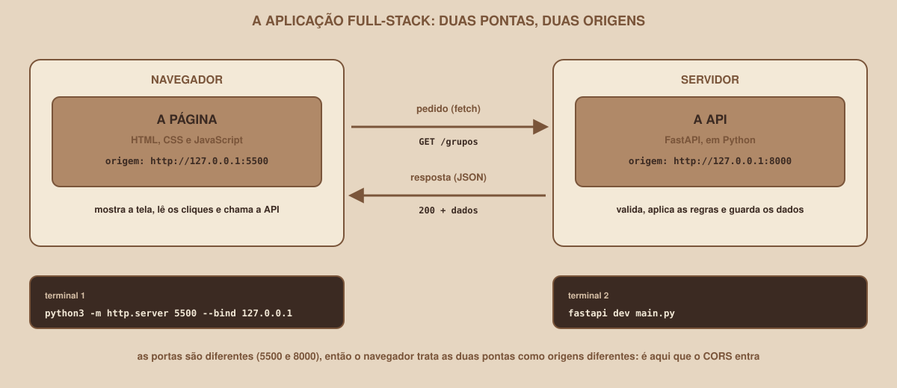

# Módulo 00, Comece Aqui

Português · [English](../docs-eng/00-start-here.md)

`SEM 06 // API RESTful Central, Parte 2: Integração`

---

## // Bem-vindo à Semana 06

Imagine que você tem duas peças prontas. A primeira é uma **página web** do Buscador de Grupos de Estudo, com uma lista, um formulário e botões. A segunda é uma **API**, um programa em Python que guarda os grupos de estudo e as matérias, e responde a pedidos pela rede. Cada peça funciona sozinha. O problema começa quando você tenta ligá-las: a página pede a lista de grupos, a API responde, e a lista **não aparece**. Nenhum erro no servidor, nenhuma linha de código errada, e mesmo assim a página não recebe os dados.

Esta semana é sobre essa ligação. Ela se chama **integração**, e quase tudo o que dá errado nela tem a ver com algo que você ainda não viu: **o navegador tem regras próprias sobre quais páginas podem ler as respostas de quais servidores**.

> **ESTA SEMANA É INDEPENDENTE**
> Esta é a Parte 2 do tema "API RESTful Central", mas foi escrita para ser lida **sozinha**. Você não precisa ter construído nenhuma API antes: a API desta semana vem **pronta**, e você só a executa. Você também não precisa saber JavaScript: os Módulos 04 a 07 apresentam o que a integração exige.

## // O que é integração full-stack

> **FULL-STACK: EM PALAVRAS SIMPLES**
> Uma aplicação *full-stack* tem as duas pontas: o **front-end** (o que roda no navegador e aparece na tela) e o **back-end** (o que roda em um servidor e guarda os dados e as regras). A **integração** é o conjunto de decisões que faz as duas pontas conversarem: quais endereços chamar, em que formato trocar os dados, e o que fazer quando algo falha.

Repare em um detalhe do desenho: as duas pontas rodam no **seu computador**, mas em **portas diferentes** (5500 e 8000). Para o navegador, isso as torna dois "sites" distintos, e é por isso que o CORS entra em cena. O Módulo 08 explica o conceito de origem, e o Módulo 09 resolve o problema.

## // O que você vai construir até o fim da semana

- Uma **página web** em HTML, CSS e JavaScript puro (sem frameworks) que lista, busca, cria, edita e apaga grupos de estudo, conversando com a API.
- Uma **API** em FastAPI configurada para aceitar, com segurança, as chamadas dessa página (CORS).
- O tratamento dos **estados da tela**: carregando, lista vazia, erro de validação, conflito e API fora do ar.
- O hábito de **diagnosticar** pela aba Rede do navegador, a principal ferramenta de quem integra sistemas.

## // O que ainda fica de fora

> **AINDA NÃO NESTA SEMANA**
> Os dados ficam **em memória**: eles voltam ao estado inicial sempre que a API reinicia. Também ficam de fora o login, os cookies e os tokens, o banco de dados, a publicação das duas pontas na internet, e os frameworks de front-end (React, Vue e outros). Aqui, o objetivo é entender a integração em si, sem nada escondendo o que acontece.

## // O que você precisa para começar

- Um computador com Windows, macOS ou Linux, e permissão para instalar programas.
- **Python 3.10 ou superior**, para executar a API pronta (o Módulo 03 mostra como).
- Um navegador atual, como Chrome, Edge ou Firefox.
- Um editor de texto ou de código (qualquer um serve) e um terminal.
- Conexão com a internet, para instalar a biblioteca da API.
- **Nenhum conhecimento prévio** de API, de JavaScript ou de CORS.

> **VERSÕES E DATA DE CONSULTA**
> O material foi verificado com **FastAPI 0.143.0**, Starlette 1.7.0, Pydantic 2.13.5, Uvicorn 0.54.0 e Python 3.12.3. A documentação oficial do FastAPI e a do MDN (sobre CORS) foram consultadas em **08/10/2026**. As respostas do servidor citadas nos módulos vêm de **execuções reais**, feitas com `curl`. Os comportamentos do **navegador** (o bloqueio do CORS, a aba Rede) seguem a documentação do MDN e **não foram reproduzidos em um navegador** durante a produção do material: as mensagens de erro exibidas aparecem como "texto típico", e variam entre navegadores. O FastAPI é uma biblioteca de versão `0.x` e muda com frequência: se algo divergir do que está aqui, a documentação oficial é a referência.

## // As duas trilhas

**Se você está começando**, nunca ligou uma página a uma API. O caminho principal assume isso: os Módulos 01 a 14 apresentam cada conceito antes de ele ser necessário, e terminam em uma aplicação funcionando.

**Se você já tem experiência**, já fez chamadas a APIs. Os Módulos 15 e 16, claramente identificados como trilha veterano e posicionados depois do essencial, cobrem os **middlewares de requisição** e a **padronização do JSON**. O Módulo 17 é um bônus da mesma trilha: como testar a integração.

As duas trilhas constroem a mesma aplicação. O que muda entre elas é a profundidade.

## // Mapa da Semana 06

| Módulo | Conteúdo | Você vai conseguir |
|---|---|---|
| 01 | HTTP visto do navegador | Ler um pedido e uma resposta pela aba Rede |
| 02 | Headers | Entender os cabeçalhos que aparecem em quase todo erro de integração |
| 03 | A API que vamos usar | Executar a API e testá-la pelo Swagger e pelo `curl` |
| 04 | JavaScript essencial para integrar | Escrever funções, objetos e arrays em JavaScript |
| 05 | O DOM: ler e mudar a página | Mostrar dados na tela, com segurança |
| 06 | Assíncrono: Promises e `async/await` | Esperar uma resposta sem travar a página |
| 07 | `fetch`: o primeiro pedido | Chamar a API e diferenciar erro de rede de erro HTTP |
| 08 | Servindo o front-end e a origem | Entender por que duas portas são duas origens |
| 09 | CORS: o navegador bloqueia | Configurar o CORS e diagnosticar quando falha |
| 10 | Listando grupos na página | Montar a lista, com busca e filtro |
| 11 | Enviando dados: formulário e `POST` | Criar grupos e mostrar os erros por campo |
| 12 | Editar e apagar: `PATCH` e `DELETE` | Alterar e remover, tratando a resposta sem corpo |
| 13 | Paginação e cabeçalhos expostos | Paginar com o total vindo de um cabeçalho |
| 14 | Projeto guiado | Ter a aplicação full-stack completa |
| 15 | Middlewares de requisição (veterano) | Identificar, medir e registrar cada pedido |
| 16 | Padronização do JSON (veterano) | Usar um formato único de resposta e de erro |
| 17 | Testando a integração (veterano, bônus) | Automatizar a verificação das duas pontas |

Cada módulo é um arquivo independente, mas foram escritos para serem lidos nesta ordem: o CORS só faz sentido depois de entender origens, e a tela só faz sentido depois de o CORS estar resolvido.

---

**Próximo módulo:** `01-http-visto-do-navegador.md`, antes de escrever código, aprenda a enxergar o que o navegador e a API trocam entre si.

`Material de Estudo // Coffee & Code`
