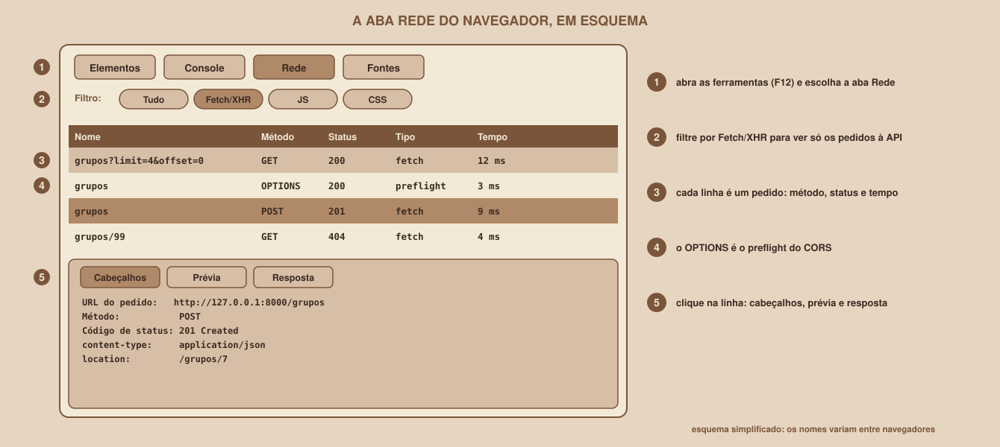

# Módulo 01, HTTP Visto do Navegador

Português · [English](../docs-eng/01-http-from-the-browser.md)

`SEM 06 // API RESTful Central, Parte 2: Integração`

---

## // Antes de começar

No Módulo 00 você viu que uma aplicação full-stack tem duas pontas que conversam. Esta conversa tem um nome, **HTTP**, e um lugar onde dá para espiá-la: a aba **Rede** do navegador. Este módulo apresenta as duas coisas, porque quem integra sistemas passa mais tempo lendo pedidos e respostas do que escrevendo código.

## // O problema: o navegador fala, e você não escuta

Uma única página web costuma fazer dezenas de pedidos: o HTML, o CSS, o JavaScript, as imagens, os dados da API. Quase nenhum deles foi escrito por você, e todos acontecem em silêncio. Quando a lista de grupos não aparece, não há mensagem dizendo "o pedido falhou aqui, com este código". Sem saber olhar os pedidos, resta adivinhar. Com a aba Rede, cada pedido vira uma linha que você pode abrir e ler.

## // O que é o HTTP

> **HTTP: EM PALAVRAS SIMPLES**
> É o protocolo, ou seja, o conjunto de regras de conversa, que o navegador e os servidores usam na web. Funciona por **pedido e resposta**: o cliente envia uma **requisição**, e o servidor devolve uma **resposta**. Cada pedido é independente: o servidor não "lembra" do anterior.

Tudo que acontece na integração desta semana é feito de pedidos e respostas HTTP. Um pedido tem quatro partes: o **método** (a ação), a **URL** (o recurso), os **cabeçalhos** (informações extras) e, às vezes, um **corpo** (dados enviados). Uma resposta tem outras três: o **código de status** (como foi), os **cabeçalhos** e, quase sempre, um **corpo**.

Esta é uma conversa real com a API desta semana, feita com o `curl` em modo detalhado. As linhas com `>` são o pedido, e as com `<` são a resposta:

```
> GET /grupos?limit=2 HTTP/1.1
> Host: 127.0.0.1:8000
> User-Agent: curl/X.Y
> Accept: */*
>
< HTTP/1.1 200 OK
< server: uvicorn
< content-length: 285
< content-type: application/json
< x-total-count: 6
<
[{"nome_grupo":"Cálculo passo a passo","materia_id":1, ... }, ... ]
```

Leitura: o cliente pediu (`GET`) o recurso `/grupos`, com o parâmetro `limit=2`, ao servidor `127.0.0.1:8000`. O servidor respondeu `200 OK`, informou que o corpo é JSON de 285 bytes, avisou que existem 6 grupos no total, e entregou o corpo. (A resposta real traz também o cabeçalho `date`, omitido aqui.)

## // Os métodos que a página vai usar

| Método | Para que serve | Exemplo nesta semana |
|---|---|---|
| `GET` | Ler, sem alterar nada | `GET /grupos?limit=4` lista os grupos |
| `POST` | Criar um recurso novo | `POST /grupos` cria um grupo |
| `PATCH` | Alterar só alguns campos de um recurso | `PATCH /grupos/3` muda o limite de participantes |
| `DELETE` | Apagar um recurso | `DELETE /grupos/3` remove o grupo |

## // Os códigos de status que você vai encontrar

O primeiro dígito conta a história: **2xx** é sucesso, **4xx** é um problema com o pedido (a culpa é de quem pediu), **5xx** é um problema no servidor. Estes são os códigos da API desta semana, todos obtidos em execuções reais:

| Código | Nome | Quando aparece | Exemplo |
|---|---|---|---|
| 200 | OK | Deu certo, com dados | `GET /grupos` |
| 201 | Created | Um recurso foi criado | `POST /grupos`, com o cabeçalho `location: /grupos/7` |
| 204 | No Content | Deu certo, **sem corpo** | `DELETE /grupos/7` |
| 404 | Not Found | O recurso pedido não existe | `GET /grupos/99` devolve `{"detail":"Grupo não encontrado"}` |
| 405 | Method Not Allowed | A rota não aceita esse método | `DELETE /grupos` |
| 409 | Conflict | O pedido conflita com o que já existe | Criar um grupo com nome repetido na mesma matéria |
| 422 | Unprocessable | Os dados enviados são inválidos | Um nome com menos de 3 caracteres |
| 500 | Internal Server Error | Falha dentro do servidor | Um erro de programação não tratado |

## // A aba Rede

<div align="center">

</div>

Todo navegador atual tem **ferramentas do desenvolvedor**, geralmente abertas com a tecla **F12** (no macOS, costuma ser Option, Command e I). Nelas, a aba **Rede** (em inglês, *Network*) lista cada pedido da página. O desenho acima é um esquema simplificado: os nomes dos botões e das abas variam entre navegadores e entre idiomas, e a aba **não foi reproduzida em um navegador** durante a produção deste material, então confira os nomes na sua tela.

O que ler em cada pedido:

| Informação | Onde aparece | Para que serve |
|---|---|---|
| Método e URL | Na linha do pedido e nos cabeçalhos | Conferir se o pedido é o que você imaginava |
| Código de status | Na coluna Status | Saber se deu certo e, se não, de quem é a culpa |
| Cabeçalhos do pedido e da resposta | No painel de detalhes | Descobrir problemas de formato e de CORS |
| Corpo da resposta | Na aba Resposta ou Prévia | Ver o que a API realmente devolveu |
| Tempo | Na coluna Tempo | Perceber pedidos lentos |

Duas dicas que poupam tempo: use o **filtro Fetch/XHR** para ver só os pedidos feitos pelo JavaScript, e, se o navegador oferecer, marque a opção de **preservar o registro**, para a lista não ser apagada quando a página recarrega.

## // Bom exemplo × mau exemplo

**Mau exemplo**: tratar o navegador como uma caixa preta:

```
"A lista não aparece. Vou mexer no código do JavaScript até funcionar."
```

Sem olhar o pedido, é impossível saber se o problema está no endereço, no servidor, nos dados ou no navegador.

**Bom exemplo**: olhar o pedido antes de mexer em qualquer coisa:

```
1. Abrir a aba Rede e recarregar a página.
2. Achar o pedido para /grupos.
3. Ler o status, os cabeçalhos e o corpo da resposta.
4. Só então decidir o que consertar.
```

## // Erros comuns

| Erro | Por que acontece | Como corrigir |
|---|---|---|
| A aba Rede está vazia | As ferramentas foram abertas **depois** de a página carregar | Abra as ferramentas e recarregue a página |
| O pedido não aparece | O filtro está escondendo (por exemplo, só JS) | Escolha "Tudo", ou o filtro Fetch/XHR |
| Confundir `200` com "funcionou na tela" | O servidor respondeu, mas o JavaScript não tratou a resposta | Veja a aba Resposta e o Console |
| Achar que `404` e `500` são a mesma coisa | Os dois são "erros" | `404` é o recurso que não existe, e `500` é uma falha do servidor |
| Esperar que o servidor lembre o pedido anterior | Em uma tela, o estado fica na página | No HTTP cada pedido é independente: leve tudo de que o servidor precisa |

## // Prática guiada

1. Abra qualquer site no navegador, pressione **F12** e abra a aba **Rede**. Recarregue a página.
2. Clique no primeiro pedido da lista e anote: o método, o código de status e o `content-type` da resposta.
3. Escolha outro pedido (uma imagem, um arquivo de estilo) e compare o `content-type`.
4. Se você já tiver o `curl`, rode `curl -v https://example.com` e identifique as linhas do pedido (`>`) e da resposta (`<`).

## // Pratique sozinho

> **DESAFIO**
> Abra três sites diferentes e, para cada um, encontre na aba Rede um pedido de cada família de status: um `2xx`, um `3xx` (redirecionamento) e, se conseguir, um `4xx`. Anote o método, a URL e o que o código significa. Se nenhum `4xx` aparecer, digite um endereço que não existe no mesmo site (por exemplo, `/pagina-que-nao-existe`) e olhe o pedido que o navegador fez.

## // Aplicando no projeto da semana

1. Crie uma pasta chamada `projeto-fullstack`, com duas subpastas vazias: `api` e `frontend`. Elas vão guardar as duas pontas da aplicação.
2. Crie, dentro da pasta, um arquivo `anotacoes-http.md` e escreva, com as suas palavras, a diferença entre os códigos `200`, `201`, `204`, `404`, `409` e `422`.
3. Se você versiona o projeto com Git, faça um commit: `git commit -m "Cria a estrutura do projeto full-stack"`.

## // Checkpoint

> **ANTES DE SEGUIR, PENSE NISTO**
> Você abre a aba Rede e vê um pedido `GET /grupos` com status `200`, mas a lista não aparece na página. O problema está na API ou na página?

Resposta: na **página**, ou em algo entre a API e a página. O status `200` mostra que a API respondeu com sucesso e entregou dados. O que falta é ver o **corpo** da resposta (o servidor mandou o que se esperava?) e o **Console** (o JavaScript falhou ao usar os dados?). É exatamente por isso que a aba Rede vem antes de qualquer mudança de código: ela divide o problema ao meio.

## // Resumo do módulo

- [ ] Sei explicar o que é o HTTP, e que cada pedido é independente.
- [ ] Sei as partes de um pedido (método, URL, cabeçalhos, corpo) e de uma resposta (status, cabeçalhos, corpo).
- [ ] Sei os métodos `GET`, `POST`, `PATCH` e `DELETE`, e o que cada um faz.
- [ ] Sei o que significam os códigos `200`, `201`, `204`, `404`, `405`, `409`, `422` e `500`.
- [ ] Sei abrir a aba Rede, filtrar por Fetch/XHR e ler status, cabeçalhos e corpo.

---

**Próximo módulo:** `02-headers.md`, os cabeçalhos aparecem em todo pedido e em toda resposta, e são a chave para entender o CORS.

`Material de Estudo // Coffee & Code`
