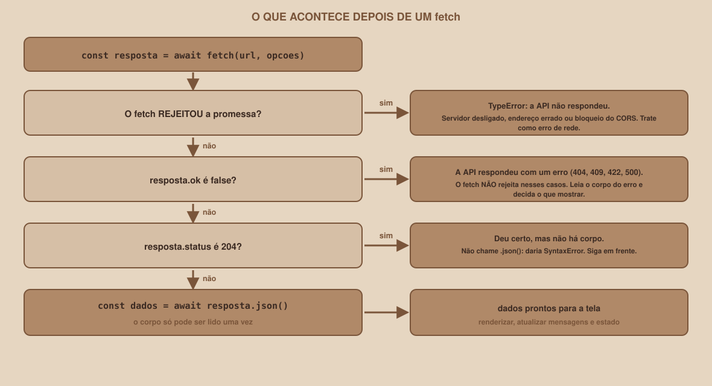

# Módulo 07, fetch: o Primeiro Pedido

Português · [English](../docs-eng/07-fetch-the-first-request.md)

`SEM 06 // API RESTful Central, Parte 2: Integração`

---

## // Antes de começar

Com HTTP, cabeçalhos, JavaScript, DOM e código assíncrono apresentados, chegou o primeiro pedido: o `fetch`, a função que o navegador oferece para falar com uma API. Neste módulo, você faz pedidos reais, lê as respostas, e aprende duas armadilhas que pegam muita gente: o `fetch` **não** rejeita em um `404`, e o `.json()` **não** funciona em um `204`.

## // O problema: um pedido tem muitos finais possíveis

Quando a página pede dados, vários finais são possíveis: a API responde com os dados; responde com um erro (`404`, `422`); responde sem corpo (`204`); ou nem responde (servidor desligado). Cada um exige uma reação diferente na tela, e o `fetch` trata esses casos de formas que surpreendem.

## // Onde fazer os primeiros testes

Ainda não vimos o CORS (Módulo 09), então, por enquanto, faça os pedidos **de dentro da própria origem da API**. Com a API rodando, abra `http://127.0.0.1:8000/docs`, as ferramentas do desenvolvedor (F12) e a aba **Console**. Como a página do Swagger e a API são da **mesma origem**, o navegador não aplica nenhuma restrição aos pedidos. (Este caminho segue a regra da mesma origem do MDN, e **não foi executado em um navegador** durante a produção do material.)

Os exemplos abaixo foram executados no Node contra a API real, e as saídas são as reais.

## // O primeiro pedido

```js
const API = "http://127.0.0.1:8000";
const resposta = await fetch(`${API}/grupos?limit=2`);
console.log(resposta.status, resposta.ok,
            resposta.headers.get("content-type"),
            resposta.headers.get("x-total-count"));
const dados = await resposta.json();
console.log(dados.length, dados[0].nome_grupo);
```

```
200 true application/json 6
2 Cálculo passo a passo
```

O `fetch` devolve uma Promise de um objeto `Response`. Ele traz:

| Propriedade | O que é |
|---|---|
| `resposta.status` | O código de status (`200`, `404`...) |
| `resposta.ok` | `true` para os códigos de `200` a `299` |
| `resposta.headers.get("nome")` | Um cabeçalho da resposta, ou `null` |
| `await resposta.json()` | O corpo, lido como JSON |
| `await resposta.text()` | O corpo, lido como texto |

Repare que são **dois** `await`: um para a resposta chegar (os cabeçalhos), outro para o corpo ser lido.

> **O CORPO SÓ PODE SER LIDO UMA VEZ**
> Ler o corpo de novo, depois de já tê-lo lido, dá erro. No Node, a mensagem é `TypeError: Body is unusable: Body has already been read` (os navegadores usam outra redação). Se precisar do mesmo corpo duas vezes, guarde o resultado da primeira leitura em uma variável.

## // O fetch não rejeita em erro HTTP

Esta é a armadilha mais comum. Um pedido que a API **respondeu com um erro** não faz o `fetch` falhar:

```js
const r404 = await fetch(`${API}/grupos/99`);
console.log(r404.status, r404.ok, await r404.json());
```

```
404 false { detail: 'Grupo não encontrado' }
```

A Promise foi **cumprida**, com uma resposta cujo `ok` é `false`. Quem escreve `try { ... } catch { ... }` e espera cair no `catch` em um `404` vai ser enganado: a página mostraria a lista como se tudo tivesse dado certo. **Sempre confira** `resposta.ok`.

O `fetch` só rejeita quando a API **nem respondeu**:

```js
try { await fetch("http://127.0.0.1:9/nada"); }
catch (e) { console.log(e.name, e.message); }
```

```
TypeError fetch failed
```

Essa é a mensagem do Node. Nos navegadores, a falha de rede também é um `TypeError`, com a redação variando (no Chrome, costuma ser `Failed to fetch`). Os motivos possíveis: o servidor está desligado, o endereço está errado, ou o navegador **bloqueou** a resposta por CORS (Módulo 09).

<div align="center">

</div>

## // Enviando dados

Para criar um grupo, o `fetch` recebe um segundo argumento, com o método, os cabeçalhos e o corpo:

```js
const criado = await fetch(`${API}/grupos`, {
  method: "POST",
  headers: { "Content-Type": "application/json" },
  body: JSON.stringify({ nome_grupo: "Teste do fetch", materia_id: 1 }),
});
console.log(criado.status, criado.headers.get("location"),
            (await criado.json()).grupo_id);
```

```
201 /grupos/7 7
```

Sem o `Content-Type`, a API recusa o corpo, como o Módulo 02 mostrou:

```
POST sem Content-Type -> 422 | detalhe: model_attributes_type
```

Quando o corpo é um texto, o padrão do `fetch` é o tipo `text/plain`, segundo a especificação, e a API só entende JSON se o cabeçalho disser que é JSON.

## // A resposta 204 não tem corpo

O `DELETE` devolve `204 No Content`: deu certo, e **não há corpo**. Chamar `.json()` nele falha:

```js
const apagado = await fetch(`${API}/grupos/7`, { method: "DELETE" });
console.log(apagado.status, apagado.ok, (await apagado.text()) === "");
```

```
204 true true
```

```js
// com outra resposta 204:
try { await apagado2.json(); } catch (e) { console.log(e.name + ":", e.message); }
```

```
SyntaxError: Unexpected end of JSON input
```

Por isso a regra do fluxo: **se o status é 204, não leia o corpo**.

## // O pedido, em uma função: pedir()

Para não repetir todos esses cuidados em cada chamada, o código da página reúne tudo em uma função, a `pedir()`, do arquivo `api.js`. Leia com calma:

```js
export const API_URL = "http://127.0.0.1:8000";

export class ErroDeRede extends Error {
  constructor() {
    super("Não foi possível falar com a API. Ela está ligada?");
    this.name = "ErroDeRede";
  }
}

export class ErroHttp extends Error {
  constructor(status, corpo) {
    super(`A API respondeu ${status}`);
    this.name = "ErroHttp";
    this.status = status;
    this.corpo = corpo;
  }
}

async function pedir(caminho, { metodo = "GET", corpo } = {}) {
  const opcoes = { method: metodo, headers: {} };
  if (corpo !== undefined) {
    opcoes.headers["Content-Type"] = "application/json";
    opcoes.body = JSON.stringify(corpo);
  }

  let resposta;
  try {
    resposta = await fetch(`${API_URL}${caminho}`, opcoes);
  } catch {
    throw new ErroDeRede();
  }

  const dados = resposta.status === 204
    ? null
    : await resposta.json().catch(() => null);

  if (!resposta.ok) throw new ErroHttp(resposta.status, dados);
  return { dados, resposta };
}
```

O que a função garante:

| Cuidado | Como a função o resolve |
|---|---|
| O `Content-Type` do JSON | Colocado sozinho sempre que existe um corpo |
| Falha de rede | Vira um `ErroDeRede`, com uma mensagem clara |
| Erro HTTP (`404`, `409`, `422`...) | Vira um `ErroHttp`, com o status e o corpo do erro |
| Resposta `204` | Não tenta ler o corpo |
| Um corpo que não é JSON | O `.catch(() => null)` evita que a função quebre |

As duas classes de erro são o coração do tratamento de erros da página: quem chama a API usa `instanceof` para decidir o que mostrar (Módulos 10 a 12).

## // Bom exemplo × mau exemplo

**Mau exemplo**: confiar no `catch` para erros HTTP:

```js
try {
  const resposta = await fetch(`${API}/grupos/99`);
  const grupo = await resposta.json();      // 404: o corpo é {"detail": ...}
  mostrar(grupo.nome_grupo);                 // undefined, sem nenhum erro
} catch (erro) {
  mostrarMensagem("Erro!");                  // nunca chega aqui em um 404
}
```

**Bom exemplo**: conferir `resposta.ok` antes de usar o corpo:

```js
const resposta = await fetch(`${API}/grupos/99`);
if (!resposta.ok) {
  mostrarMensagem(`A API respondeu ${resposta.status}.`);
  return;
}
const grupo = await resposta.json();
```

## // Erros comuns

| Erro | Por que acontece | Como corrigir |
|---|---|---|
| A tela mostra `undefined` em um `404` | O `fetch` não rejeitou, e o corpo de erro foi tratado como dado | Confira `resposta.ok` |
| `Unexpected end of JSON input` | `.json()` em uma resposta `204` | Não leia o corpo quando o status for `204` |
| `Body is unusable` | O corpo foi lido duas vezes | Guarde o resultado da primeira leitura |
| `422` ao criar um grupo | Faltou o `Content-Type: application/json` | Acrescente o cabeçalho |
| `TypeError: Failed to fetch` com a API ligada | O navegador bloqueou a resposta (CORS), ou o endereço está errado | Veja a aba Rede e o Módulo 09 |
| Esquecer o `JSON.stringify` no corpo | O corpo precisa ser texto | `body: JSON.stringify(objeto)` |

## // Prática guiada

1. Ligue a API. Abra `http://127.0.0.1:8000/docs`, as ferramentas (F12) e o Console.
2. Cole o primeiro pedido e confira o status, o `content-type` e o `x-total-count`.
3. Peça o grupo `99` e confirme que o `fetch` **não** rejeita, mas `ok` é `false`.
4. Crie um grupo com `POST` e leia o `location`. Depois apague-o e confirme o `204`.
5. Desligue a API, repita o pedido e leia o `TypeError`.
6. No `frontend/api.js`, copie a função `pedir()` e as duas classes de erro.

## // Pratique sozinho

> **DESAFIO**
> Escreva a função `buscarGrupo(id)` usando a `pedir()`. Teste com um grupo que existe, com o `99` (e capture o `ErroHttp`, imprimindo o `status`) e com a API desligada (e capture o `ErroDeRede`). Para cada caso, escreva em um comentário o que a tela deveria mostrar.

## // Aplicando no projeto da semana

1. Crie `projeto-fullstack/frontend/api.js` com o `API_URL`, as duas classes de erro e a função `pedir()`.
2. Acrescente a função exportada `listarMaterias()`, que devolve `(await pedir("/materias")).dados`.
3. Se você versiona o projeto com Git, faça um commit: `git commit -m "Cria a camada de acesso à API"`.

## // Checkpoint

> **ANTES DE SEGUIR, PENSE NISTO**
> Alguém em um fórum diz que "o `fetch` dá erro quando a API responde `500`". Por que isso está errado, e que consequência tem para a tela?

Resposta: o `fetch` só **rejeita** quando não há resposta nenhuma (rede, servidor desligado, bloqueio do navegador). Um `500` é uma resposta como outra qualquer: a Promise é cumprida, e `resposta.ok` é `false`. Se a página só trata o `catch`, o `500` passa despercebido e a tela fica com dados vazios ou quebrados, sem explicação. A defesa é conferir `resposta.ok` (ou usar uma função como a `pedir()`, que transforma o erro HTTP em um `ErroHttp`).

## // Resumo do módulo

- [ ] Sei fazer um `GET` com `fetch` e ler `status`, `ok`, cabeçalhos e o corpo.
- [ ] Sei que o `fetch` só rejeita quando a API nem responde, e **não** em `404`, `409`, `422` ou `500`.
- [ ] Sei enviar JSON com `method`, `Content-Type` e `JSON.stringify`.
- [ ] Sei que o corpo só pode ser lido uma vez, e que uma resposta `204` não tem corpo.
- [ ] Entendo a função `pedir()` e as classes `ErroDeRede` e `ErroHttp`.

---

**Próximo módulo:** `08-servindo-o-front-end-e-a-origem.md`, os pedidos funcionam de dentro da API. O próximo passo cria, de propósito, o problema que o CORS vai resolver.

`Material de Estudo // Coffee & Code`
