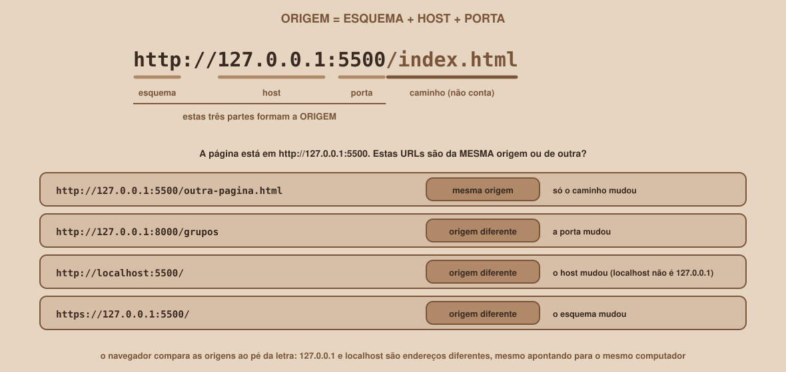

# Módulo 08, Servindo o Front-end e a Origem

Português · [English](../docs-eng/08-serving-the-front-end-and-the-origin.md)

`SEM 06 // API RESTful Central, Parte 2: Integração`

---

## // Antes de começar

No Módulo 07, os pedidos funcionaram porque saíram de dentro da própria API. A página real vai morar em outro lugar: uma pasta no seu computador. Este módulo mostra como servi-la corretamente, apresenta o conceito de **origem**, e termina provocando de propósito o problema que o Módulo 09 resolve.

## // O problema: um arquivo aberto com duplo clique não é um site

É tentador abrir o `index.html` com um duplo clique. O navegador abre a página, e ela até parece funcionar. Mas o endereço na barra começa com `file://`, e não com `http://`, e isso muda o que o navegador permite: a página passa a ter uma origem especial chamada `null`, e recursos como os módulos do JavaScript podem ser bloqueados. Para integrar com uma API, a página precisa ser servida por um **servidor web**, mesmo que simples.

## // Servindo a página

O Python traz um servidor web pronto. Em um **segundo terminal** (o primeiro continua com a API), entre na pasta do front-end e rode:

```
python3 -m http.server 5500 --bind 127.0.0.1
```

(No Windows, troque `python3` por `py`.) O terminal mostra:

```
Serving HTTP on 127.0.0.1 port 5500 (http://127.0.0.1:5500/) ...
```

Abra `http://127.0.0.1:5500` no navegador: a página aparece. A cada arquivo pedido, o servidor escreve uma linha de registro no terminal:

```
127.0.0.1 - - [09/Oct/2026 02:29:11] "GET / HTTP/1.1" 200 -
```

| Parte do comando | Para que serve |
|---|---|
| `python3 -m http.server` | Liga o servidor web embutido do Python, na pasta onde você está |
| `5500` | A porta. Qualquer número livre serve, mas vamos usar sempre este |
| `--bind 127.0.0.1` | Atende **só o seu computador** |
| `--directory pasta` | Serve outra pasta, sem precisar entrar nela (opcional) |

O servidor entrega cada arquivo com o tipo certo, verificado em execução: `index.html` como `text/html`, `app.js` como `text/javascript` e `estilos.css` como `text/css`. O tipo do JavaScript importa: os módulos exigem que ele seja entregue como JavaScript.

> **SEM O --BIND, O SERVIDOR ATENDE A SUA REDE INTEIRA**
> Em um teste, o mesmo comando **sem** `--bind` anunciou `Serving HTTP on 0.0.0.0 port 5520`, e a pasta passou a responder `200` por **outro endereço da máquina**. O `0.0.0.0` significa "todas as redes": qualquer pessoa na mesma rede (a Wi-Fi do campus, por exemplo) conseguiria abrir os seus arquivos. Use sempre o `--bind 127.0.0.1`.

## // O que é uma origem

> **ORIGEM: EM PALAVRAS SIMPLES**
> É a combinação de **esquema** (`http`), **host** (`127.0.0.1`) e **porta** (`5500`) de um endereço. O caminho não conta. Duas URLs são da mesma origem só se as três partes forem idênticas.

<div align="center">

</div>

Com isso, a aplicação desta semana tem **duas origens**:

| Parte | Endereço | Origem |
|---|---|---|
| A página | `http://127.0.0.1:5500` | esquema `http`, host `127.0.0.1`, porta `5500` |
| A API | `http://127.0.0.1:8000` | esquema `http`, host `127.0.0.1`, porta `8000` |

Só a porta é diferente, e isso basta: **são origens diferentes**. O mesmo vale para `localhost` e `127.0.0.1`: os dois apontam para o seu computador, mas o navegador os compara como texto, e eles não são iguais.

## // A política de mesma origem

> **POLÍTICA DE MESMA ORIGEM: EM PALAVRAS SIMPLES**
> É a regra de segurança básica do navegador: o JavaScript de uma página só pode **ler** as respostas de pedidos feitos à **mesma origem** dela. Para ler a resposta de outra origem, o servidor dessa outra origem precisa autorizar de forma explícita (é o CORS, assunto do próximo módulo).

É por isso que o Módulo 07 funcionou: a página do Swagger e a API eram da mesma origem (`http://127.0.0.1:8000`). A página nova, na porta 5500, não é.

## // O experimento: provocando o problema

Com a API no ar (porta 8000, ainda **sem CORS**, a versão `api-inicial`) e a página servida (porta 5500), abra `http://127.0.0.1:5500`, as ferramentas do desenvolvedor (F12) e a aba **Console**. No arquivo `app.js`, escreva:

```js
const API = "http://127.0.0.1:8000";

const resposta = await fetch(`${API}/grupos?limit=2`);
console.log(await resposta.json());
```

Salve e recarregue a página. O que o navegador deve fazer, segundo as regras desta seção: **não** entregar a resposta ao seu código, e escrever um erro de CORS no console. O texto exato varia entre navegadores, e esta mensagem **não foi reproduzida** durante a produção do material.

Mas você já sabe o que o servidor viu, pois o testamos com o `curl`: ele respondeu `200`, com os dados. A API não tem nada de errado. O que falta é a **autorização** do servidor, e o Módulo 09 mostra como ela funciona e como configurá-la.

## // Bom exemplo × mau exemplo

**Mau exemplo**: abrir a página com duplo clique:

```
file:///C:/Users/ana/projeto-fullstack/frontend/index.html
```

A origem é `null`, e módulos e pedidos podem ser bloqueados de formas confusas.

**Bom exemplo**: servir a pasta e abrir pelo endereço do servidor:

```
python3 -m http.server 5500 --bind 127.0.0.1
http://127.0.0.1:5500
```

## // Erros comuns

Estas mensagens e comportamentos foram obtidos ao executar os comandos.

| Erro | Por que acontece | Como corrigir |
|---|---|---|
| `OSError: [Errno 98] Address already in use` | Já existe um servidor na porta 5500 (talvez o de um teste anterior) | Pare o outro com Ctrl+C no terminal dele, ou use outra porta |
| `404`, e `code 404, message File not found` no terminal | O servidor foi iniciado na pasta errada, ou o arquivo não existe | Entre na pasta que contém o `index.html` e rode de novo |
| A página abre, mas o JavaScript antigo continua rodando | O navegador guardou o arquivo antigo em cache | Recarregue sem cache (em geral, Ctrl+Shift+R), ou marque "desativar cache" nas ferramentas |
| O servidor atende outros computadores da rede | Faltou o `--bind 127.0.0.1` | Pare e rode de novo com o `--bind` |
| Abrir a página por `file://` | Duplo clique no arquivo | Sirva a pasta e use `http://127.0.0.1:5500` |
| `python3: command not found` no Windows | O comando no Windows é `py` | Use `py -m http.server 5500 --bind 127.0.0.1` |

## // Prática guiada

1. Copie `example/frontend-inicial` para `projeto-fullstack/frontend`.
2. Em um terminal, dentro dessa pasta, rode `python3 -m http.server 5500 --bind 127.0.0.1` e abra `http://127.0.0.1:5500`.
3. Olhe o terminal: confira as linhas de registro de `GET / ` e dos arquivos de estilo e de script.
4. Com a API (`api-inicial`) ligada em outro terminal, abra o Console e rode o experimento deste módulo.
5. Troque o endereço da página para `http://localhost:5500` e responda: a origem é a mesma de `127.0.0.1:5500`?
6. Pare o servidor com Ctrl+C e tente subir outro na mesma porta, enquanto o primeiro está de pé: leia o erro.

## // Pratique sozinho

> **DESAFIO**
> Suba **dois** servidores estáticos ao mesmo tempo, nas portas 5500 e 5501, servindo a mesma pasta. Escreva, para cada um, a origem da página. Responda: uma página aberta em `5501` poderia ler as respostas da API sem CORS? E uma página aberta em `5501` poderia ler as de uma página em `5500`? Justifique com a definição de origem.

## // Aplicando no projeto da semana

1. Anote no `README.md`, na seção "Como rodar", os dois comandos: o da API e o do servidor da página, com o `--bind`.
2. Registre as duas origens da aplicação e a regra de mesma origem em uma linha.
3. Se você versiona o projeto com Git, faça um commit: `git commit -m "Documenta como servir o front-end"`.

## // Checkpoint

> **ANTES DE SEGUIR, PENSE NISTO**
> A página está em `http://127.0.0.1:5500` e a API em `http://127.0.0.1:5500/api`, na **mesma porta**, atrás do mesmo servidor. Elas são da mesma origem? E se a API ficasse em `https://127.0.0.1:5500`?

Resposta: no primeiro caso, **sim**: esquema, host e porta são iguais, e o caminho (`/api`) não conta, então o navegador as trata como a mesma origem, sem CORS. No segundo, **não**: o esquema mudou de `http` para `https`, e basta uma das três partes diferir para a origem ser outra.

## // Resumo do módulo

- [ ] Sei servir a pasta do front-end com `python3 -m http.server 5500 --bind 127.0.0.1`.
- [ ] Sei por que o `--bind 127.0.0.1` importa, e por que não abrir a página por `file://`.
- [ ] Sei definir origem (esquema, host e porta) e comparar duas origens.
- [ ] Sei por que `localhost` e `127.0.0.1` são origens diferentes.
- [ ] Sei o que é a política de mesma origem.
- [ ] Sei provocar o problema do CORS, e que a API em si não está errada.

---

**Próximo módulo:** `09-cors-o-navegador-bloqueia.md`, o servidor precisa autorizar a página. É assim que o CORS resolve o problema.

`Material de Estudo // Coffee & Code`
