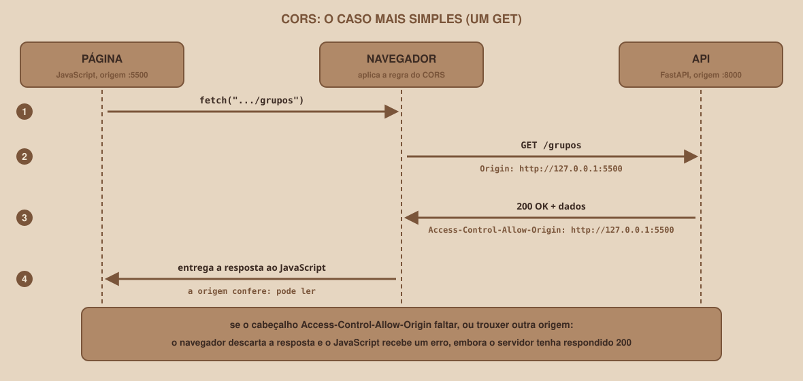
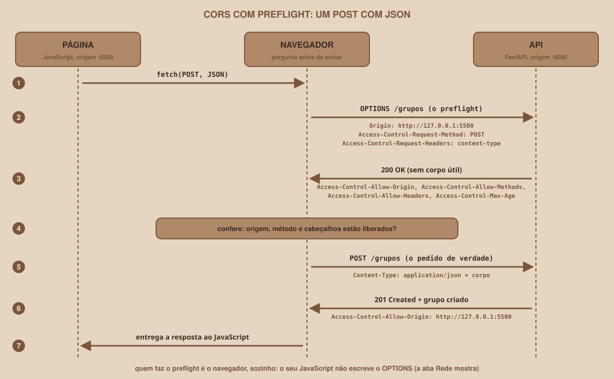
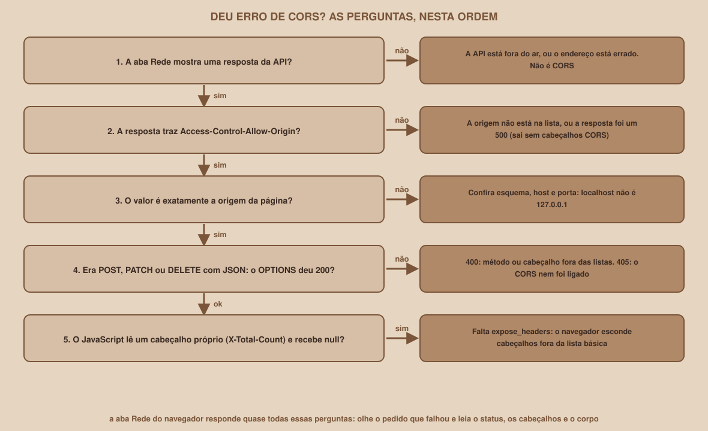

# Módulo 09, CORS: o Navegador Bloqueia

Português · [English](../docs-eng/09-cors-the-browser-blocks.md)

`SEM 06 // API RESTful Central, Parte 2: Integração`

---

## // Antes de começar

No Módulo 08 você serviu a página na porta `5500` e viu que a API mora na porta `8000`: duas **origens** diferentes. No Módulo 07, o `fetch` que chamava a API funcionava bem pelo `curl` e pelo Swagger. Agora que ele roda dentro da página, algo muda. Este módulo explica o que muda, por que, e como resolver, e é o mais importante da semana: quase toda integração entre uma página e uma API passa por ele.

## // O problema: a API responde, e a página não recebe

Com a página aberta em `http://127.0.0.1:5500`, este código no `app.js` pede dois grupos à API:

```js
const API = "http://127.0.0.1:8000";

fetch(`${API}/grupos?limit=2`)
  .then((resposta) => resposta.json())
  .then((dados) => console.log(dados))
  .catch((erro) => console.error("Falhou:", erro));
```

No console do navegador, a lista não aparece. Em vez dela, surge um erro. O texto típico, no Chrome, é este (a redação exata varia entre navegadores, e esta mensagem **não foi reproduzida** durante a produção do material):

```
Access to fetch at 'http://127.0.0.1:8000/grupos?limit=2' from origin
'http://127.0.0.1:5500' has been blocked by CORS policy: No
'Access-Control-Allow-Origin' header is present on the requested resource.
```

A frase assusta, porque parece dizer que a API recusou o pedido. Mas veja o que o servidor **realmente** respondeu, usando o `curl` com o mesmo cabeçalho `Origin` que o navegador envia:

```
curl -i -H "Origin: http://127.0.0.1:5500" "http://127.0.0.1:8000/grupos?limit=2"

HTTP/1.1 200 OK
content-type: application/json
x-total-count: 6

[{"nome_grupo":"Cálculo passo a passo","materia_id":1, ... },
 {"nome_grupo":"Estruturas na prática","materia_id":2, ... }]
```

O servidor respondeu **200 OK, com os dados completos**. O pedido não foi recusado, e nenhuma linha de Python falhou. A resposta chegou ao navegador, e **o navegador a descartou**, antes de entregá-la ao seu JavaScript. É um comportamento de segurança do navegador, e é isso que o CORS regula.

## // O que é o CORS

> **ORIGEM: EM PALAVRAS SIMPLES**
> É a combinação de **esquema** (`http`), **host** (`127.0.0.1`) e **porta** (`5500`) de um endereço. O caminho não conta. Duas URLs são da mesma origem só se as três partes forem idênticas.

<div align="center">

</div>

> **CORS: EM PALAVRAS SIMPLES**
> *Cross-Origin Resource Sharing* (compartilhamento de recursos entre origens) é um mecanismo, baseado em cabeçalhos HTTP, pelo qual o **servidor** informa quais outras origens o **navegador** pode deixar ler as suas respostas. Por padrão, um navegador não entrega a uma página a resposta de uma origem diferente da dela.

Esse padrão existe por segurança. Sem ele, qualquer página aberta no seu navegador poderia fazer pedidos, como você, a outros sites onde você está conectado, e ler as respostas. Fonte: documentação do MDN sobre CORS, consultada em 08/10/2026.

Duas ideias precisam ficar claras desde já:

1. **Quem aplica a regra é o navegador**, e não o servidor. O servidor só declara, por cabeçalhos, o que permite.
2. **O CORS só existe em navegadores.** O `curl`, o Swagger servido pela própria API, e outro programa em Python não aplicam essa regra. Por isso o mesmo pedido "funciona" por fora e "falha" na página.

## // Como o servidor autoriza: o caso mais simples

<div align="center">

</div>

Em um `GET` simples, o navegador envia o pedido normalmente, mas acrescenta o cabeçalho `Origin` com a origem da página. A API responde, e o navegador procura na resposta o cabeçalho `Access-Control-Allow-Origin`:

- Se ele trouxer **a origem da página** (ou `*`), o navegador entrega a resposta ao JavaScript.
- Se ele **faltar**, ou trouxer **outra origem**, o navegador descarta a resposta e o `fetch` falha com um erro.

Compare a resposta real da API **com CORS configurado** (o `curl` é o mesmo do início):

```
HTTP/1.1 200 OK
x-total-count: 6
access-control-expose-headers: X-Total-Count
access-control-allow-origin: http://127.0.0.1:5500
vary: Origin
```

O cabeçalho `access-control-allow-origin` é a **autorização**: ele repete a origem da página. O `vary: Origin` avisa aos caches que a resposta depende da origem de quem pediu. O `access-control-expose-headers` é assunto do Módulo 13.

## // O preflight: quando o navegador pergunta antes

Nem todo pedido segue o caminho simples. Um pedido **só é simples** se usa `GET`, `HEAD` ou `POST` e envia apenas cabeçalhos considerados seguros pela especificação (o `Content-Type`, por exemplo, só pode ter os valores `application/x-www-form-urlencoded`, `multipart/form-data` ou `text/plain`). Fonte: MDN.

Quase todo pedido da sua página **não** é simples: enviar JSON (`Content-Type: application/json`), usar `PATCH` ou `DELETE`. Nesses casos, antes do pedido de verdade, o navegador faz um pedido de **verificação**, chamado **preflight** (voo de reconhecimento), com o método `OPTIONS`.

<div align="center">

</div>

O preflight é feito **pelo navegador, sozinho**: o seu JavaScript não o escreve. Mas você o enxerga na aba Rede, e o servidor precisa saber responder a ele. Veja o preflight de um `POST` em JSON, e a resposta real da API **com CORS**:

```
curl -i -X OPTIONS \
  -H "Origin: http://127.0.0.1:5500" \
  -H "Access-Control-Request-Method: POST" \
  -H "Access-Control-Request-Headers: content-type" \
  http://127.0.0.1:8000/grupos

HTTP/1.1 200 OK
access-control-allow-origin: http://127.0.0.1:5500
access-control-allow-methods: GET, POST, PATCH, DELETE
access-control-allow-headers: Accept, Accept-Language, Content-Language,
                              Content-Type
access-control-max-age: 600
vary: Origin, Access-Control-Request-Method,
      Access-Control-Request-Headers,
      Access-Control-Request-Private-Network
content-type: text/plain; charset=utf-8

OK
```

Cada cabeçalho `Access-Control-Request-*` do pedido é uma **pergunta** ("posso usar `POST`? posso enviar `content-type`?"), e cada `Access-Control-Allow-*` da resposta é a **resposta** a ela. O `access-control-max-age: 600` diz ao navegador que ele pode reaproveitar essa resposta por até 600 segundos, sem repetir o preflight.

E a mesma pergunta feita à API **sem CORS** (a do início do módulo):

```
HTTP/1.1 405 Method Not Allowed
allow: GET
{"detail":"Method Not Allowed"}
```

A API não sabe responder ao `OPTIONS`, devolve `405`, e o navegador conclui que o `POST` não está liberado. Nenhum `POST` chega a ser enviado.

## // Configurando o CORS no FastAPI

O FastAPI traz uma peça pronta para isso, o `CORSMiddleware`. Um *middleware* é um trecho de código que fica entre o servidor e as rotas, e que vê todo pedido e toda resposta (o Módulo 15 explora isso a fundo). No `main.py` da API, acrescente:

```python
from fastapi.middleware.cors import CORSMiddleware

ORIGENS_PERMITIDAS = [
    "http://127.0.0.1:5500",
    "http://localhost:5500",
]

app.add_middleware(
    CORSMiddleware,
    allow_origins=ORIGENS_PERMITIDAS,
    allow_methods=["GET", "POST", "PATCH", "DELETE"],
    allow_headers=["Content-Type"],
    expose_headers=["X-Total-Count"],
)
```

| Parâmetro | O que declara | Valor aqui |
|---|---|---|
| `allow_origins` | As origens cujas páginas podem **ler** as respostas | As duas formas de abrir a página local |
| `allow_methods` | Os métodos liberados no preflight | Os quatro que a página usa |
| `allow_headers` | Os cabeçalhos de pedido liberados | `Content-Type`, para enviar JSON |
| `expose_headers` | Os cabeçalhos de **resposta** que o JavaScript pode ler | `X-Total-Count` (Módulo 13) |
| `allow_credentials` | Se cookies acompanham os pedidos | Não usado: fica no padrão, que é desligado |
| `max_age` | Por quanto tempo o navegador guarda o preflight | Padrão: 600 segundos |

Salve o arquivo: o `fastapi dev` recarrega sozinho. A configuração, nesta versão, está descrita na documentação oficial do FastAPI, consultada em 08/10/2026.

## // Testando o CORS sem navegador

Você não precisa do navegador para conferir a configuração. O `curl`, com o cabeçalho `Origin`, mostra exatamente o que o servidor responde. Estes são os resultados reais, e eles formam uma pequena **bateria de testes** que você pode repetir sempre que mexer no CORS:

| Teste | Resultado | O que significa |
|---|---|---|
| `GET` com `Origin: http://127.0.0.1:5500` | `200`, com `access-control-allow-origin` | A página liberada consegue ler |
| `GET` com `Origin: http://localhost:3000` | `200`, **sem** `access-control-allow-origin` | Origem fora da lista: o navegador bloquearia |
| `GET` com `Origin: null` | `200`, **sem** `access-control-allow-origin` | Página aberta por `file://`: bloqueada |
| Preflight de `POST` | `200` | Liberado |
| Preflight de `PUT` | `400`, `Disallowed CORS method` | `PUT` não está em `allow_methods` |
| Preflight com `authorization` | `400`, `Disallowed CORS headers` | O cabeçalho não está em `allow_headers` |
| Preflight de origem fora da lista | `400`, `Disallowed CORS origin` | Origem recusada |

> **O CORS NÃO PROTEGE A SUA API**
> Repare na segunda linha da tabela: a origem `http://localhost:3000` **não está na lista**, e mesmo assim o servidor respondeu `200 OK` com os dados. O servidor não bloqueou nada: ele só **deixou de incluir** o cabeçalho de autorização, e o navegador é quem barra a leitura. Quem chama a API por `curl`, por um script ou por um aplicativo ignora o CORS por completo. Para proteger dados de verdade, são necessários **autenticação e permissões**, assunto fora desta semana. O CORS decide só **qual página, em um navegador, pode ler a resposta**.

## // As armadilhas mais comuns

Cada uma destas foi reproduzida em uma execução real.

| Armadilha | O que acontece | Como evitar |
|---|---|---|
| **Só a origem foi configurada** | O padrão do `CORSMiddleware` libera só `GET`. O preflight de `DELETE` ou `PATCH` devolve `400 Disallowed CORS method` | Declare `allow_methods` com tudo que a página usa |
| **localhost e 127.0.0.1** | São origens diferentes. Uma página aberta em `http://localhost:5500` não é atendida se só `127.0.0.1:5500` estiver na lista | Liste as duas, ou abra a página sempre pelo mesmo endereço |
| **A página aberta por file://** | O navegador envia `Origin: null`, que não está na lista | Sirva a página por um servidor (`python3 -m http.server`), como no Módulo 08 |
| **`allow_origins=["*"]` "para resolver"** | Qualquer site passa a poder ler as respostas da API | Liste só as origens reais |
| **`"*"` junto com `allow_credentials=True`** | A documentação diz que não se pode combinar os dois, mas o Starlette **não dá erro**: ele passa a **ecoar a origem de quem pediu**, com `access-control-allow-credentials: true` | Nunca combine. Com credenciais, liste as origens |
| **A API devolve um 500** | A resposta de erro sai **sem** cabeçalhos CORS, e o navegador mostra um erro de CORS no lugar do erro real | Aprenda a reconhecer o sintoma (veja a árvore abaixo). O Módulo 15 mostra uma correção |
| **Barra final na URL** | `GET /grupos/` devolve `307 Temporary Redirect` para `http://127.0.0.1:8000/grupos`. O redirecionamento adiciona uma volta de rede | Chame sempre o endereço exato, sem barra final |
| **Mudou o CORS e nada mudou** | O navegador pode reaproveitar o preflight por até `access-control-max-age` (600 segundos) | Recarregue com a aba Rede aberta e confira o preflight novo |

Duas dessas armadilhas merecem a prova de que são reais. Com o CORS configurado só com `allow_origins` (padrão no resto), o preflight de `DELETE` responde:

```
HTTP/1.1 400 Bad Request
Disallowed CORS method
access-control-allow-methods: GET
```

E com `allow_origins=["*"]` e `allow_credentials=True`, um pedido vindo de `https://qualquer.com` recebe:

```
access-control-allow-origin: https://qualquer.com
access-control-allow-credentials: true
```

O servidor **repetiu a origem de um site qualquer** e ainda autorizou o envio de credenciais. É a combinação mais perigosa de todas, e não dá nenhum aviso.

## // Diagnosticando um erro de CORS

Quando a página falha, não adivinhe. Siga as perguntas, **nesta ordem**, olhando a aba Rede do navegador:

<div align="center">

</div>

A primeira pergunta é a que mais economiza tempo: se **nenhuma resposta** aparece na aba Rede, o problema **não é CORS**. A API está fora do ar, ou o endereço está errado, e o navegador mostra um erro parecido.

## // Bom exemplo × mau exemplo

**Mau exemplo**: liberar tudo para o erro sumir:

```python
app.add_middleware(
    CORSMiddleware,
    allow_origins=["*"], allow_methods=["*"], allow_headers=["*"],
    allow_credentials=True,
)
```

O erro some, mas qualquer site do mundo passa a poder ler as respostas da API, e a combinação com `allow_credentials=True` faz o servidor ecoar qualquer origem.

**Bom exemplo**: uma lista exata do que a página realmente usa:

```python
ORIGENS_PERMITIDAS = ["http://127.0.0.1:5500", "http://localhost:5500"]

app.add_middleware(
    CORSMiddleware,
    allow_origins=ORIGENS_PERMITIDAS,
    allow_methods=["GET", "POST", "PATCH", "DELETE"],
    allow_headers=["Content-Type"],
    expose_headers=["X-Total-Count"],
)
```

## // Erros comuns

| Erro | Por que acontece | Como corrigir |
|---|---|---|
| A lista não aparece, e o console fala de CORS | A resposta veio sem `access-control-allow-origin` | Configure o `CORSMiddleware` e confira a origem |
| O `GET` funciona, mas o `POST` e o `DELETE` falham | Faltou `allow_methods`, ou o preflight devolveu `400` | Inclua os métodos usados e teste o preflight com `curl` |
| Funciona em `127.0.0.1` e falha em `localhost` | São origens diferentes | Acrescente as duas a `allow_origins` |
| O servidor devolve `200`, mas a página dá erro | O navegador descartou a resposta (CORS) | Compare com o `curl -H "Origin: ..."` |
| `405` ao testar o preflight | O `CORSMiddleware` não foi adicionado ao `app` | Acrescente o `add_middleware` e reinicie |
| Erro de CORS que some quando a API não quebra | A API devolveu um `500`, que sai sem cabeçalhos CORS | Veja o log da API: o erro real está lá |

## // Prática guiada

1. Abra dois terminais. No primeiro, na pasta `api-inicial`, ative o ambiente e rode `fastapi dev main.py`. No segundo, na pasta `frontend-inicial`, rode `python3 -m http.server 5500 --bind 127.0.0.1`.
2. Abra `http://127.0.0.1:5500` no navegador, com as ferramentas do desenvolvedor abertas (tecla **F12**), na aba **Console**.
3. Escreva no `app.js` o código do início deste módulo, salve e recarregue a página. Observe o erro, e depois abra a aba **Rede** e localize o pedido: leia o status e os cabeçalhos da resposta.
4. Rode o `curl` com `Origin` (comando do início do módulo) e confirme que o servidor respondeu `200` sem o cabeçalho de autorização.
5. No `main.py`, acrescente o `CORSMiddleware` com a configuração do "bom exemplo". Salve (a API recarrega sozinha) e recarregue a página: a lista de dois grupos aparece no console.
6. Rode o preflight de `POST` com `curl` e compare com a resposta do módulo.
7. Abra a página por `http://localhost:5500` e veja o que muda. Depois acrescente a origem que falta, salve, e confira de novo.

## // Pratique sozinho

> **DESAFIO**
> Escreva, com `curl`, o preflight de um `PATCH` em `/grupos/1` vindo da origem `http://127.0.0.1:5500`, e depois o de um `PUT`. Antes de rodar, preveja o status e o corpo de cada um. Depois, mude `allow_methods` para remover o `PATCH`, e confirme a diferença. Por fim, acrescente a origem `http://127.0.0.1:5501` e prove, com um `GET` e `Origin`, que ela passou a ser autorizada.

## // Aplicando no projeto da semana

1. Deixe o `CORSMiddleware` configurado no `main.py` da sua API, com a lista `ORIGENS_PERMITIDAS` em uma constante no alto do arquivo.
2. Crie, no `README.md` do projeto, a seção "CORS" com a lista das origens permitidas e a justificativa de cada uma.
3. Guarde o `curl` do preflight em um arquivo `testes-cors.md`: ele será a sua bateria de testes do CORS.
4. Se você versiona o projeto com Git, faça um commit: `git commit -m "Configura o CORS da API"`.

## // Checkpoint

> **ANTES DE SEGUIR, PENSE NISTO**
> Uma pessoa lê em um fórum que, para resolver o erro de CORS, basta usar `allow_origins=["*"]`. O erro realmente some. O que está certo nessa dica, e o que está arriscado?

Resposta: está certo que o erro some, porque o servidor passa a enviar `access-control-allow-origin: *` e o navegador libera a leitura para **qualquer** página. O risco é exatamente esse: **qualquer site** passa a poder ler as respostas da API a partir do navegador de quem o visita. Para uma API pública, sem dados sensíveis, isso pode ser aceitável. Para uma API com dados de pessoas, ou que um dia use cookies, não é. Piora muito se for combinado com `allow_credentials=True`, porque o Starlette, nesse caso, passa a ecoar qualquer origem. A prática segura é listar só as origens reais da sua página.

## // Resumo do módulo

- [ ] Sei explicar o que é uma origem (esquema, host e porta) e por que `localhost` e `127.0.0.1` são diferentes.
- [ ] Sei explicar o que é o CORS e que **quem o aplica é o navegador**.
- [ ] Sei por que o `curl` e o Swagger funcionam e a página falha.
- [ ] Sei a diferença entre um pedido simples e um que exige **preflight**, e o que o `OPTIONS` pergunta.
- [ ] Sei configurar o `CORSMiddleware` com origens, métodos, cabeçalhos e cabeçalhos expostos.
- [ ] Sei testar o CORS com `curl` e o cabeçalho `Origin`.
- [ ] Sei que o CORS **não** protege a API, e que `"*"` com credenciais é perigoso.
- [ ] Sei seguir a árvore de diagnóstico, começando por "a aba Rede mostra uma resposta?".

---

**Próximo módulo:** `10-listando-grupos-na-pagina.md`, o CORS está resolvido. Hora de transformar a resposta da API em uma lista de verdade na página.

`Material de Estudo // Coffee & Code`
