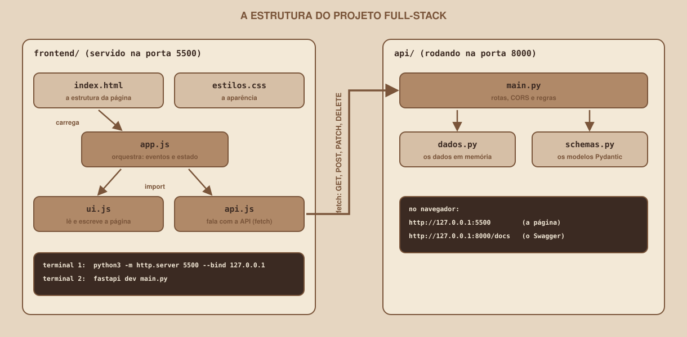

# Módulo 14, Projeto Guiado

Português · [English](../docs-eng/14-guided-project.md)

`SEM 06 // API RESTful Central, Parte 2: Integração`

---

## // Antes de começar

Todas as peças já foram apresentadas: a API, o servidor da página, o CORS, a listagem, o formulário, a edição, a exclusão e a paginação. Este módulo as junta em **uma aplicação full-stack** e dá um roteiro de verificação para conferir, ponto a ponto, que tudo está conectado. O resultado é o entregável da semana.

## // O desenho final

<div align="center">

</div>

A estrutura do projeto:

```
projeto-fullstack/
├── README.md
├── api/
│   ├── main.py
│   ├── dados.py
│   ├── schemas.py
│   └── requirements.txt
└── frontend/
    ├── index.html
    ├── estilos.css
    ├── api.js
    ├── ui.js
    └── app.js
```

Cada arquivo tem **uma** responsabilidade:

| Arquivo | Responsabilidade |
|---|---|
| `api/main.py` | As rotas, as regras e a configuração do CORS |
| `api/dados.py` | Os dados de exemplo, em memória |
| `api/schemas.py` | O formato dos dados (os modelos) |
| `frontend/index.html` | A estrutura da página |
| `frontend/estilos.css` | A aparência |
| `frontend/api.js` | O único lugar que conhece o endereço da API e o `fetch` |
| `frontend/ui.js` | O único lugar que lê e escreve a página |
| `frontend/app.js` | A orquestração: eventos, estado e os estados da tela |

A regra por trás da divisão: **cada arquivo muda por um único motivo**. Se o endereço da API mudar, só o `api.js` muda. Se o visual dos cartões mudar, só o `ui.js` e o CSS.

## // Montando, passo a passo

1. **Estrutura.** Crie a árvore acima. A pasta `api` vem de `example/api` (a versão **com CORS**), e a `frontend`, de `example/frontend`, ou das suas próprias versões dos arquivos escritos nos módulos anteriores.
2. **A API.** No primeiro terminal, dentro de `api`, ative o ambiente virtual e rode `fastapi dev main.py`. Confirme que `http://127.0.0.1:8000/docs` abre.
3. **O front-end.** No segundo terminal, dentro de `frontend`, rode `python3 -m http.server 5500 --bind 127.0.0.1`.
4. **A página.** Abra `http://127.0.0.1:5500`, com as ferramentas do desenvolvedor (F12) abertas na aba Rede e na aba Console.
5. **Os dados.** Lembre-se: a API guarda tudo em memória. Se ela reiniciar (o `fastapi dev` reinicia a cada arquivo salvo), os dados voltam ao início.

## // O roteiro de verificação

Percorra cada item, na ordem, e marque. Os itens de 1 a 14 foram verificados em testes automatizados com a API real, e a descrição do que aparece nas abas do navegador segue a documentação e **não foi reproduzida em um navegador**.

| # | O que fazer | O que deve acontecer |
|---|---|---|
| 1 | Abrir a página | O indicador mostra "API conectada" |
| 2 | Olhar a lista | Quatro grupos, em ordem alfabética: `Cálculo passo a passo`, `Estruturas na prática`, `Modelagem e SQL`, `Processos e memória` |
| 3 | Olhar a paginação | `Página 1 de 2 (6 grupos)`, com **Anterior** desabilitado |
| 4 | Clicar em **Próxima** | `Redes na unha` e `Requisitos e histórias`, e **Próxima** desabilitado |
| 5 | Buscar `prática` | Só `Estruturas na prática`, e `Página 1 de 1 (1 grupo)` |
| 6 | Buscar `zzz` | "Nenhum grupo encontrado." |
| 7 | Escolher a matéria `Banco de Dados` | Só `Modelagem e SQL` |
| 8 | Criar `Cálculo II na prática`, matéria Cálculo I, limite 5 | "Grupo criado.", formulário limpo, `Página 1 de 2 (7 grupos)` |
| 9 | Enviar o nome `ab` | O erro `String should have at least 3 characters` no campo do nome |
| 10 | Criar o mesmo grupo de novo | O erro de conflito no campo do nome |
| 11 | Editar o grupo criado, mudando o limite para 8 | "Grupo atualizado.", o cartão mostra "Até 8 participantes" |
| 12 | Apagar o grupo, cancelando e depois confirmando | Cancelar não apaga; confirmar apaga e volta a `6 grupos` |
| 13 | Criar três grupos extras, ir à página 3 e apagar o único item dela | Volta para a página 2, sem mostrar "Página 3 de 2" |
| 14 | Parar a API (Ctrl+C) e buscar algo | O indicador muda para "API fora do ar" e a mensagem explica o que houve |

Mais três conferências, só possíveis no navegador:

| # | Onde olhar | O que deve aparecer |
|---|---|---|
| 15 | Aba Rede, ao criar um grupo | Um `OPTIONS` (preflight) com `200`, e depois o `POST` com `201` |
| 16 | Aba Rede, nos cabeçalhos da listagem | `access-control-allow-origin` com `http://127.0.0.1:5500`, e `access-control-expose-headers` com `X-Total-Count` |
| 17 | Aba Console | Nenhum erro vermelho durante todo o roteiro (o aviso do passo 14 é esperado) |

## // Se algo não funcionar

Siga a árvore do Módulo 09 e olhe sempre a aba Rede antes de mexer no código. Os problemas mais comuns desta montagem:

| Sintoma | Causa provável | Onde conferir |
|---|---|---|
| A lista não aparece, e o console fala de CORS | A origem da página não está em `ORIGENS_PERMITIDAS` | `main.py` e o endereço na barra |
| "API fora do ar" com a API ligada | O endereço em `API_URL` está errado, ou a API usa outra porta | `api.js` e o terminal da API |
| A paginação mostra "0 grupos" | Faltou o `expose_headers` | `main.py` (Módulo 13) |
| `PATCH` e `DELETE` falham, `GET` e `POST` funcionam | Faltam métodos em `allow_methods` | `main.py` (Módulo 09) |
| Os grupos que criei sumiram | A API reiniciou: os dados vivem em memória | É o esperado |
| Nada muda ao salvar um arquivo `.js` | O navegador guardou o arquivo em cache | Recarregue sem cache (em geral, Ctrl+Shift+R) |

## // Verificação automática (opcional)

Os itens 1 a 14 foram verificados por um teste automatizado, que carrega a página em um ambiente que simula o navegador (`jsdom`) e conversa com a API real. Ele **não aplica o CORS** (é o navegador de verdade que o aplica), por isso não substitui os itens 15 a 17. O Módulo 17 mostra como rodá-lo.

## // Bom exemplo × mau exemplo

**Mau exemplo**: entregar sem percorrer o roteiro:

```
"Funcionou quando eu testei a listagem. Deve estar tudo certo."
```

Os casos que quebram aplicações são os de borda: a lista vazia, o nome repetido, a API fora do ar, a última página.

**Bom exemplo**: percorrer os 17 itens, anotando o resultado de cada um:

```
1 ok | 2 ok | 3 ok | ... | 13 ok (corrigi: voltava para a página 3) | 14 ok
```

## // Erros comuns

| Erro | Por que acontece | Como corrigir |
|---|---|---|
| A API roda, mas a página não a encontra | As duas pontas não estão ligadas ao mesmo tempo | Confira os dois terminais abertos |
| O `README.md` não explica como rodar | A documentação ficou para depois | Escreva os dois comandos e as duas origens |
| Os arquivos da página foram servidos da pasta errada | O terminal estava fora de `frontend` | Rode o servidor dentro de `frontend` |
| Um `.venv` foi enviado ao repositório | Faltou o `.gitignore` | Acrescente `.venv/` ao `.gitignore` |
| O endereço da API ficou espalhado pelo código | O `fetch` foi chamado em vários arquivos | Mantenha tudo no `api.js` |

## // Prática guiada

1. Monte a estrutura do projeto e suba as duas pontas.
2. Percorra os 17 itens do roteiro, em ordem, anotando o resultado de cada um.
3. Para cada item que falhar, use a árvore do Módulo 09 e a aba Rede para achar a causa, e corrija.
4. Escreva o `README.md` do projeto (veja o `entregavel.md`).

## // Pratique sozinho

> **DESAFIO**
> Escolha um item do roteiro e **quebre-o de propósito**: por exemplo, tire o `expose_headers`, ou tire o `PATCH` de `allow_methods`. Rode o roteiro, anote os sintomas na tela, no Console e na aba Rede, e escreva, em três linhas, como você reconheceria esse defeito se ele aparecesse sem aviso. Depois, restaure.

## // Aplicando no projeto da semana

1. O projeto completo, com a API e o front-end, é o entregável: veja o `entregavel.md`.
2. Revise o `README.md`: como rodar as duas pontas, quais são as origens e o que cada arquivo faz.
3. Se você versiona o projeto com Git, faça o commit final: `git commit -m "Conclui a aplicação full-stack"`.

## // Checkpoint

> **ANTES DE SEGUIR, PENSE NISTO**
> O roteiro tem 17 itens, e um teste automatizado cobre 14 deles. Por que ele não cobre os três últimos, e por que isso importa?

Resposta: porque o teste automatizado roda em um ambiente que **simula** o navegador, e esse ambiente, usando o `fetch` do Node, **não aplica o CORS**. Os itens 15 a 17 (preflight, cabeçalhos de CORS, ausência de erros no console) só existem em um navegador real. Isso importa porque o CORS é justamente a parte da integração que mais costuma falhar: um teste verde não prova que o navegador vai aceitar as respostas. A conferência manual no navegador continua sendo indispensável.

## // Resumo do módulo

- [ ] Montei o projeto com as duas pastas e as duas pontas rodando.
- [ ] Sei a responsabilidade de cada arquivo e por que cada um muda por um único motivo.
- [ ] Percorri os 17 itens do roteiro e corrigi o que falhou.
- [ ] Sei usar a aba Rede e a árvore do Módulo 09 para diagnosticar um sintoma.
- [ ] Sei o que um teste automatizado confirma e o que ele não consegue confirmar.

---

**Próximo módulo:** `entregavel.md` para revisar o que a semana pede, ou `15-middlewares-de-requisicao.md` para a trilha veterano.

`Material de Estudo // Coffee & Code`
