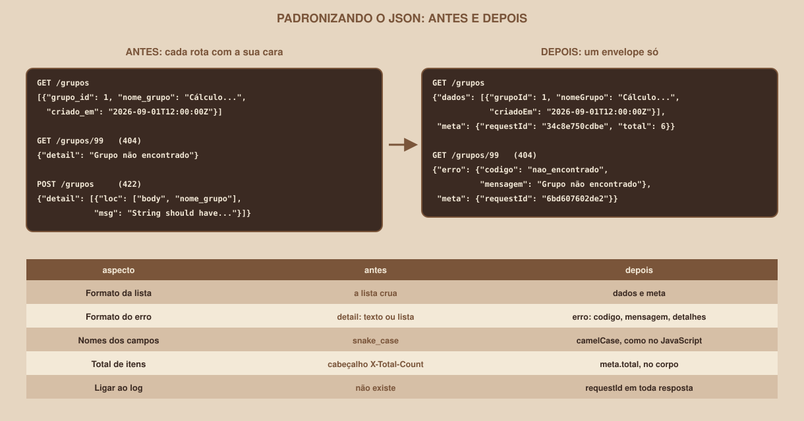

# Módulo 16, Padronização do JSON

Português · [English](../docs-eng/16-json-standardization.md)

`SEM 06 // API RESTful Central, Parte 2: Integração`

---

## // Antes de começar

> **TRILHA VETERANO**
> Este módulo faz parte da trilha veterano: ele vem depois do conteúdo essencial e não é necessário para o entregável da semana. Quem segue a trilha principal pode pular para o `entregavel.md`.

A API que você usou até aqui devolve cada resposta com a sua própria cara: uma lista crua, um erro em texto, outro erro em lista, nomes de campo com sublinhado. Funciona, mas obriga a página a conhecer cada exceção. Este módulo cria **um formato único** para as respostas e para os erros, que a página aprende uma vez e usa em tudo. O código completo está em `example/veterano/`.

## // O problema: cada resposta com a sua cara

Estas são respostas reais da API da trilha principal:

| Situação | Corpo da resposta | O que a página precisa saber |
|---|---|---|
| Lista de grupos | `[{"grupo_id": 1, ...}]` | Que a resposta **é** a lista |
| Grupo inexistente (`404`) | `{"detail": "Grupo não encontrado"}` | Que o erro é um **texto** em `detail` |
| Dados inválidos (`422`) | `{"detail": [{"loc": [...], "msg": ...}]}` | Que o erro é uma **lista** em `detail` |
| Total de grupos | O cabeçalho `x-total-count` | Que o total vive **fora** do corpo |
| Campos | `nome_grupo`, `criado_em` | Que os nomes usam **sublinhado** (e o JavaScript, camelCase) |

Cada diferença vira um `if` no código da página. Padronizar significa decidir **uma** forma, e fazer a API cumprir sempre.

## // O desenho do formato

<div align="center">

</div>

Um **envelope** é um objeto que embrulha a resposta. Aqui, existem dois:

**Sucesso:** `{ "dados": ..., "meta": ... }`

```json
{
  "dados": [{
    "nomeGrupo": "Cálculo passo a passo", "materiaId": 1,
    "maxParticipantes": 6, "descricao": null,
    "grupoId": 1, "criadoEm": "2026-09-01T12:00:00Z"
  }],
  "meta": {"requestId": "34c8e750cdbe", "total": 6, "limit": 2, "offset": 0}
}
```

**Erro:** `{ "erro": { "codigo", "mensagem", "detalhes" }, "meta": ... }`

```json
{
  "erro": {
    "codigo": "nao_encontrado",
    "mensagem": "Grupo não encontrado",
    "detalhes": null
  },
  "meta": {"requestId": "6bd607602de2"}
}
```

| Campo | O que é |
|---|---|
| `dados` | O que a página pediu: um item ou uma lista |
| `meta` | Informações **sobre** a resposta: o identificador do pedido (Módulo 15) e, nas listas, o total e a paginação |
| `erro.codigo` | Um texto curto e **estável**, feito para o código ler (`nao_encontrado`, `conflito`...) |
| `erro.mensagem` | O texto para a **pessoa** ler |
| `erro.detalhes` | Uma lista de pontos específicos (usada na validação), ou `null` |

A página passa a decidir pelo **código**, e não pelo texto da mensagem: a mensagem pode ser reescrita ou traduzida sem quebrar nada.

Os códigos desta API:

| `erro.codigo` | Status | Quando |
|---|---|---|
| `nao_encontrado` | `404` | O grupo (ou a rota) não existe |
| `metodo_nao_permitido` | `405` | A rota não aceita esse método |
| `conflito` | `409` | Nome repetido na mesma matéria |
| `regra_de_negocio` | `422` | Uma regra da API foi violada (por exemplo, matéria inexistente) |
| `validacao` | `422` | Dados inválidos, com a lista de campos em `detalhes` |
| `erro_interno` | `500` | Um erro inesperado (Módulo 15) |

## // Passo 1: nomes em camelCase

O JavaScript usa `nomeGrupo`, e o Python usa `nome_grupo`. Em vez de escolher um lado, o Pydantic converte automaticamente, com um **gerador de apelidos**:

```python
from pydantic import BaseModel, ConfigDict
from pydantic.alias_generators import to_camel


class Base(BaseModel):
    # alias_generator: no JSON, nomeGrupo; no Python, nome_grupo.
    # populate_by_name: o Python ainda pode usar o nome com sublinhado.
    model_config = ConfigDict(alias_generator=to_camel, populate_by_name=True)


class GrupoOut(Base):
    grupo_id: int
    nome_grupo: str
    criado_em: datetime
```

O resultado, em respostas reais:

| Direção | Exemplo |
|---|---|
| A API **devolve** | `{"grupoId": 3, "nomeGrupo": "Modelagem e SQL", "maxParticipantes": 8, "criadoEm": "2026-09-03T12:00:00Z"}` |
| A API **aceita** (camelCase) | `POST /grupos` com `{"nomeGrupo":"Cálculo II na prática","materiaId":1,"maxParticipantes":5}` devolve `201` |
| A API **também aceita** (sublinhado) | Por causa do `populate_by_name=True`: `{"nome_grupo": "...", "materia_id": 5}` devolve `201` |

O Swagger acompanha: ele documenta os nomes em camelCase (`nomeGrupo`, `requestId`), porque lê os apelidos. As **datas** já saem no padrão ISO 8601, em UTC, com o `Z` no fim (`2026-09-03T12:00:00Z`), e o JavaScript as lê com `new Date(...)`.

O nome de um **parâmetro de consulta** também precisa de apelido, porque ele não passa pelo modelo:

```python
materia_id: Annotated[int | None, Query(alias="materiaId")] = None
```

## // Passo 2: o envelope de sucesso

O envelope é um modelo **genérico**: ele serve para qualquer tipo de `dados`.

```python
T = TypeVar("T")


class MetaDeLista(Base):
    request_id: str
    total: int
    limit: int
    offset: int


class RespostaLista(Base, Generic[T]):
    """Envelope de uma lista: { dados, meta } com o total e a paginação."""

    dados: list[T]
    meta: MetaDeLista
```

Na rota, a resposta é declarada com o tipo (`RespostaLista[GrupoOut]`), e a rota devolve um dicionário:

```python
@app.get("/grupos", response_model=RespostaLista[GrupoOut], tags=["grupos"])
def listar_grupos(request: Request, q: str | None = None, ...):
    ...
    return {
        "dados": grupos[offset : offset + limit],
        "meta": meta_do(request, total=len(grupos), limit=limit, offset=offset),
    }
```

Como o envelope é declarado no `response_model`, o **Swagger o documenta**: ele mostra a estrutura `dados` e `meta`, e os nomes dos modelos geram `RespostaLista_GrupoOut_`. Documentação e API contam a mesma história.

> **O DELETE NÃO TEM ENVELOPE**
> A resposta `204 No Content` **não tem corpo** (Módulo 07), então não há onde pôr um envelope. Isso é normal: o formato único vale para as respostas **com corpo**. A página já sabe tratar o `204` pela `pedir()`.

## // Passo 3: o envelope de erro

Os tratadores de erro do módulo anterior montam o envelope de erro em **um lugar só**:

```python
def resposta_de_erro(
    request: Request, status_code: int, codigo: str, mensagem: str,
    detalhes=None, headers=None,
) -> JSONResponse:
    erro = {"codigo": codigo, "mensagem": mensagem, "detalhes": detalhes}
    corpo = {"erro": erro, "meta": _meta(request)}
    return JSONResponse(corpo, status_code=status_code, headers=headers)


def registrar_tratadores(app: FastAPI) -> None:
    @app.exception_handler(StarletteHTTPException)
    async def tratar_erro_http(request: Request, erro: StarletteHTTPException):
        codigo = CODIGO_POR_STATUS.get(erro.status_code, "erro_http")
        mensagem = MENSAGEM_PADRAO.get(str(erro.detail), str(erro.detail))
        return resposta_de_erro(
            request, erro.status_code, codigo, mensagem,
            headers=getattr(erro, "headers", None),
        )

    @app.exception_handler(RequestValidationError)
    async def tratar_validacao(request: Request, erro: RequestValidationError):
        detalhes = [
            {"campo": ".".join(str(p) for p in e["loc"]), "mensagem": e["msg"]}
            for e in erro.errors()
        ]
        return resposta_de_erro(
            request, 422, "validacao",
            "Os dados enviados são inválidos", detalhes,
        )
```

O primeiro tratador cobre os erros que as rotas levantam (`404`, `409`, `422` de regra) e também os que o próprio framework gera (rota e método inexistentes), e traduz as mensagens padrão em inglês. O segundo transforma o erro de validação em uma lista de campos. O `500` é o do pega-tudo do Módulo 15.

Respostas reais, para os mesmos erros da página:

| Pedido | Resposta |
|---|---|
| `POST /grupos` com `nomeGrupo` `"ab"` e `materiaId` `0` | `422`, `"codigo":"validacao"`, com um item em `detalhes` para cada campo (veja abaixo) |
| `POST /grupos` com uma matéria que não existe | `422`, `"codigo":"regra_de_negocio"`, `"mensagem":"A matéria 99 não existe"` |
| `POST /grupos` com um nome repetido | `409`, `"codigo":"conflito"`, `"mensagem":"Já existe um grupo com esse nome nessa matéria"` |
| `PATCH /grupos/7` com `nomeGrupo` igual a `null` | `422`, `"codigo":"validacao"`, `"campo":"body.nomeGrupo"` |
| `DELETE /grupos` | `405`, `"codigo":"metodo_nao_permitido"`, `"mensagem":"Método não permitido para este recurso"`, e o cabeçalho `allow: GET` mantido |

O corpo completo do primeiro caso:

```
POST /grupos   {"nomeGrupo": "ab", "materiaId": 0}

422  {
  "erro": {
    "codigo": "validacao",
    "mensagem": "Os dados enviados são inválidos",
    "detalhes": [
      {"campo": "body.nomeGrupo",
       "mensagem": "String should have at least 3 characters"},
      {"campo": "body.materiaId",
       "mensagem": "Input should be greater than 0"}
    ]
  },
  "meta": {"requestId": "74c1e241d7b5"}
}
```

Repare que, na validação, os nomes dos campos saem em camelCase (`body.nomeGrupo`), coerentes com o resto da API.

## // Passo 4: a página aprende o formato uma vez

Toda a mudança do front-end cabe em **um arquivo**, o `api.js`, que passa a desembrulhar o envelope:

```js
const envelope = resposta.status === 204
  ? null
  : await resposta.json().catch(() => null);
if (!resposta.ok) {
  const idDoPedido = resposta.headers.get("X-Request-ID");
  throw new ErroHttp(resposta.status, envelope, idDoPedido);
}
return { dados: envelope?.dados ?? null, meta: envelope?.meta ?? null };
```

E a listagem lê o total do **corpo**, e não de um cabeçalho:

```js
const { dados, meta } = await pedir(`/grupos?${parametros}`);
// o total agora vem no corpo, não em um cabeçalho
return { grupos: dados, total: meta.total };
```

Uma consequência boa: o total deixa de depender do `expose_headers` (Módulo 13). O restante do `api.js` não precisa mudar. A diferença que sobra está nos nomes: o `ui.js` e o `app.js` passam a usar `nomeGrupo`, `materiaId`, `maxParticipantes` e `grupoId`. E o tratamento de erros passa a usar o **código** (`erro.codigo === "validacao"`), com a lista de campos pronta em `erro.detalhes`:

```js
if (erro instanceof api.ErroHttp && erro.codigo === "validacao") {
  mostrarErrosDeValidacao(erro.detalhes);
} else if (erro instanceof api.ErroHttp && erro.codigo === "conflito") {
  ui.mostrarErroDeCampo(
    "nomeGrupo", "Já existe um grupo com esse nome nessa matéria."
  );
}
```

O **mesmo teste automatizado** do front-end, sem mudar uma linha, passa com a API padronizada e a página adaptada: os 12 passos conferidos (Módulo 17). A padronização mudou o formato, e não o comportamento.

## // O preço da padronização

| Ganho | Custo |
|---|---|
| A página aprende **um** formato para tudo | O JSON ganha um nível a mais de aninhamento |
| O código do erro é estável: a mensagem pode mudar | O `204` continua sem envelope: o formato único vale só para respostas com corpo |
| O `requestId` liga a tela ao log, em toda resposta | Um cliente que já usava a API antiga **quebra**: mudar o formato é uma mudança incompatível |
| O Swagger e a API combinam | O formato novo precisa ser documentado e mantido por todos que mexem na API |

Essa última linha da tabela é a mais importante em um sistema de verdade: mudar o formato de uma API que já tem clientes exige combinar a mudança, e em geral se publica uma **versão nova** (por exemplo, sob `/v2`) em vez de alterar a antiga. Aqui, como a API é só de estudo, a troca é direta.

## // Bom exemplo × mau exemplo

**Mau exemplo**: a página decide pelo texto da mensagem:

```js
if (erro.message.includes("Já existe")) { /* conflito */ }
```

Se alguém corrigir a redação da mensagem, a página quebra sem aviso.

**Bom exemplo**: a página decide pelo código estável:

```js
if (erro.codigo === "conflito") { /* conflito */ }
```

## // Erros comuns

| Erro | Por que acontece | Como corrigir |
|---|---|---|
| A página mostra `undefined` nos campos | A página lê `nome_grupo`, e a API devolve `nomeGrupo` | Atualize os nomes em `ui.js` e `app.js` |
| O filtro por matéria parou de funcionar | O parâmetro agora se chama `materiaId` | Use `materiaId` na consulta |
| `422` ao enviar `nome_grupo` pela página | O modelo espera `nomeGrupo` | Envie em camelCase (`populate_by_name` aceita os dois, mas o padrão é camelCase) |
| O total aparece como `0` | O `api.js` ainda lê o cabeçalho `X-Total-Count` | Leia `meta.total` |
| Tentar ler `dados` de uma resposta `204` | Não há corpo | Trate o `204` antes de desembrulhar |
| Um erro sem `meta.requestId` | O tratador montou o erro sem o `_meta(request)` | Use sempre a função `resposta_de_erro` |
| O Swagger mostra o formato antigo | O `response_model` não foi atualizado | Declare `RespostaItem[...]` e `RespostaLista[...]` nas rotas |

## // Prática guiada

1. Rode a API veterano (`example/veterano/api`) e faça `curl -i "http://127.0.0.1:8000/grupos?limit=2"`: identifique `dados`, `meta` e o `requestId` no corpo e no cabeçalho.
2. Provoque, pelo `curl`, um `404`, um `409` e um `422`, e compare cada resposta com a tabela do módulo.
3. Envie um `POST` em camelCase e depois em sublinhado: os dois devem funcionar.
4. Abra o `/docs` e procure `RespostaLista_GrupoOut_`: veja a estrutura do envelope.
5. Sirva o front-end veterano (`example/veterano/frontend`) e percorra o roteiro do Módulo 14: nada deve ter mudado para a pessoa que usa a tela.

## // Pratique sozinho

> **DESAFIO**
> Acrescente ao `meta` das listas o campo `totalDePaginas`, calculado na API (`ceil(total / limit)`), e faça a página usá-lo no lugar da conta que ela faz sozinha. Pense nas consequências: o que muda se o tamanho da página for definido pela página, e não pela API? E em quais lugares a conta ficaria duplicada?

## // Aplicando no projeto da semana

1. Se você seguiu a trilha veterano, aplique o `alias_generator`, os envelopes e os tratadores de erro à sua API.
2. Adapte o seu `api.js` para desembrulhar o envelope e usar o `codigo` dos erros.
3. No `README.md`, documente o formato de sucesso, o formato de erro e a tabela de códigos.
4. Se você versiona o projeto com Git, faça um commit: `git commit -m "Padroniza o JSON da API"`.

## // Checkpoint

> **ANTES DE SEGUIR, PENSE NISTO**
> Por que o `erro.codigo` (`conflito`) é mais seguro para a página decidir do que o `erro.mensagem`?

Resposta: porque o código é um **contrato estável**, e a mensagem é um texto para pessoas, que pode ser corrigido, reescrito ou traduzido a qualquer momento. Se a página decide pela mensagem, qualquer ajuste na redação a quebra, e o defeito só aparece quando alguém tropeça nele. O código muda só quando a API muda de verdade, e uma mudança assim é combinada. A regra: **código para máquinas, mensagem para pessoas**.

## // Resumo do módulo

- [ ] Sei por que respostas com formatos diferentes pesam no código da página.
- [ ] Sei desenhar um envelope de sucesso (`dados` e `meta`) e um de erro (`erro` e `meta`).
- [ ] Sei converter os nomes para camelCase com `alias_generator` e `populate_by_name`.
- [ ] Sei criar um modelo genérico de envelope e declará-lo no `response_model`.
- [ ] Sei concentrar a montagem dos erros em um só lugar, com códigos estáveis.
- [ ] Sei adaptar o `api.js` para desembrulhar o envelope, e decidir pelo código do erro.
- [ ] Sei que mudar o formato de uma API com clientes exige combinar, e em geral versionar.

---

**Próximo módulo:** `17-testando-a-integracao.md`, um módulo bônus: como conferir as duas pontas de forma automática.

`Material de Estudo // Coffee & Code`
